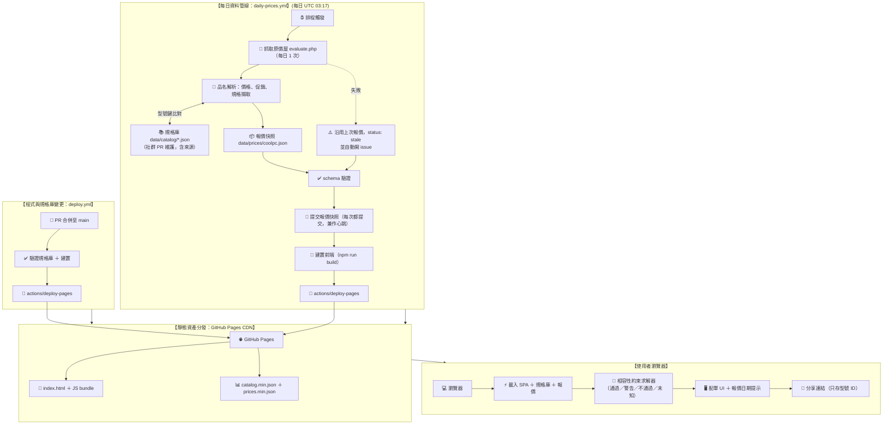

# 壹、系統架構與資料流水線設計 (System Architecture & Data Pipeline)

> **核心架構裁決**：「**GitHub Pages 託管純前端 ＋ GitHub Actions 每日抓取報價快照 ＋ 前端相容性約束求解**」可行，[PoC](poc/README.md) 已在 GitHub Actions 上實測驗證：能抓到原價屋估價頁，並能從品名自動擷取大部分相容性規格。
> 主機費用為 $0／月，但並非零維運：維運工作轉移到**規格庫整理**與**通路改版時修正爬蟲**兩件事（見本文第四節）。
>
> 2026-10 依 [設計審查](06-design-review.md) 與 [規格庫 schema](07-spec-catalog-schema.md) 修訂。主要改動：每日流程改為單一 workflow 完成「抓取 → 驗證 → 提交 → 建置 → 部署」；資料格式改為型號／報價兩層。

---

## 一、系統架構全景拓撲 (System Architecture Topology)



**為什麼價格更新必須在同一個 workflow 內部署**：以預設 `GITHUB_TOKEN` 推送的 commit 不會觸發其他 workflow。若像舊版設計一樣「爬蟲 commit → 由 `deploy.yml` 的 `on: push` 部署」，價格永遠不會上線。

---

## 二、資料分層：型號規格 vs 每日報價

完整定義見 [`07-spec-catalog-schema.md`](07-spec-catalog-schema.md)；機器可讀 schema 在 [`schema/`](schema/)。

| 資料 | 檔案 | 更新頻率 | 維護方式 |
| :--- | :--- | :--- | :--- |
| **規格庫**（型號層） | `data/catalog/<類別>.json` | 新品上市、人工修正時 | 自動擷取產生草稿，社群以 PR 確認、修正 |
| **報價快照**（報價層） | `data/prices/<通路>.json` | 每日 | 每日 workflow 自動產生 |
| **前端用精簡檔** | `public/data/catalog.min.json`、`prices.min.json` | 建置時產生 | 去掉來源資訊與原始品名 |

### 1. 為什麼分兩層

通路報價每天變動、寫法混亂；型號的物理規格相對穩定。PoC 進一步發現**通路的一列不等於一個零件**：

- 同型號黑、白各一列，價格不同 → 型號底下有「變體」，價格掛在報價列；
- 機殼類有「機殼＋電源／水冷／風扇」組合列 → 一個報價列可以包含多個零件；
- 原價屋 option value 在 2,320 列中有 370 個重複 → 不能直接當報價 ID。

### 2. 規格值一律帶來源

品名可以自動擷取大部分規格（CPU、記憶體、電源 100%，主機板 99%，機殼 98%，顯卡 97%，散熱器 96%），但品名本身是近似值：顯卡長度只到公分（實測高估 5 ~ 7 mm）、機殼間隙常省略條件。因此每個欄位都記錄來源（品名、原廠規格、人工……）與誤差，缺少的欄位視為「未知」，不填預設值。

```json
// data/catalog/gpu.json（節錄）
"gpu:msi:rtx5080-16g-ventus-3x-oc": {
  "category": "gpu", "brand": "微星 MSI", "name": "RTX5080 16G VENTUS 3X OC", "status": "active",
  "specs": {
    "length_mm": { "value": 303, "source": "retailer_spec", "ref": "https://…", "note": "品名寫 31cm" }
  },
  "review": { "status": "verified" }
}
```

```json
// data/prices/coolpc.json（節錄）
{
  "offer_id": "coolpc:h3f2a9c1e",
  "category": "cpu",
  "price": 4450,
  "price_condition": { "type": "requires_category", "requires": ["motherboard"], "note": "【任搭主機板】" },
  "items": [{ "role": "main", "model_id": "cpu:amd:ryzen-5-8400f", "match": "model_key" }]
}
```

### 3. 實測體積（2026-10-12 原價屋全量）

| 檔案 | 原始 | gzip |
| :-- | --: | --: |
| 前端規格庫 `catalog.min.json`（1,837 型號） | 270 KB | 31 KB |
| 前端報價 `prices.min.json`（2,320 列，不含原始品名） | 542 KB | 40 KB |
| repo 內報價快照（含原始品名） | 1,016 KB | 84 KB |

舊版估計的報價快照 ~80 KB／gzip 18 KB 偏低約一倍。每日提交約 1 MB 的快照會讓 repo 歷史持續增長（gzip 後約 84 KB／日）；若成為問題，可改放獨立的資料分支或 release asset。

---

## 三、每日資料管線 (`.github/workflows/daily-prices.yml`)

### 1. 排程與執行成本

- **排程**：每天 UTC 03:17（台灣 11:17）。選這個時間沒有實測依據，等每日資料累積後可比較各時段的價格變動再調整。
- **排程不保證準時**：GitHub 的排程在尖峰時段可能延遲，偶爾會被跳過。前端以快照內的 `fetched_at` 顯示報價日期，不假設每天一定更新。
- **公開 repo 60 天無活動會停用排程**：每次執行都會寫入 `last_attempt_at` 並提交，即使價格沒變也有提交，兼作心跳。
- **費用**：公開 repo 的 GitHub-hosted runner 免費。PoC 實測單次抓取約 2 秒、解析與驗證數秒，加上前端建置，每次執行預估在數分鐘內。

### 2. Workflow

> **實作狀態（2026-10）**：[`.github/workflows/daily-prices.yml`](.github/workflows/daily-prices.yml) 已實作抓取、驗證、提交與失敗開 issue，提交後呼叫 [`deploy.yml`](.github/workflows/deploy.yml) 建置並部署網站（部署為獨立 job，失敗不影響報價提交）。程式在 [`pipeline/`](pipeline/) 與 [`scripts/update_prices.py`](scripts/update_prices.py)；新型號由 [`catalog-bootstrap.yml`](.github/workflows/catalog-bootstrap.yml) 每週一自動找出並開 PR 送審（也可手動觸發）；PR 與 main 的離線檢查在 [`ci.yml`](.github/workflows/ci.yml)。下方為完成後的目標樣貌。

```yaml
name: Daily price update

on:
  schedule:
    - cron: '17 3 * * *'   # UTC 03:17 = 台灣 11:17
  workflow_dispatch:

permissions:
  contents: write    # 提交報價快照
  pages: write       # 部署
  id-token: write    # 部署
  issues: write      # 抓取失敗時開 issue

concurrency:
  group: pages             # 與 deploy.yml 共用，避免兩次部署互相覆蓋
  cancel-in-progress: false

jobs:
  update-and-deploy:
    runs-on: ubuntu-latest
    timeout-minutes: 15
    environment:
      name: github-pages
      url: ${{ steps.deployment.outputs.page_url }}
    steps:
      - uses: actions/checkout@v4

      - uses: actions/setup-python@v5
        with:
          python-version: '3.11'
          cache: 'pip'

      - run: pip install -r requirements.txt

      # 抓取失敗時不覆寫 offers，改寫 status: stale 並保留上次的 fetched_at；
      # 以 step output 回報，讓後續仍可提交心跳並部署「資料過舊」提示
      - name: Crawl price snapshot
        id: crawl
        run: python scripts/update_prices.py --out data/prices/coolpc.json

      - name: Validate catalog and prices
        run: python schema/validate.py --catalog data/catalog/*.json --prices data/prices/*.json

      # last_attempt_at 每次都會更新，因此每次都有變更可提交；
      # 這個提交不會觸發其他 workflow（GITHUB_TOKEN 的限制），所以部署在本 job 內完成
      - name: Commit snapshot (every run, doubles as heartbeat)
        run: |
          git config user.name "github-actions[bot]"
          git config user.email "41898282+github-actions[bot]@users.noreply.github.com"
          git add data/prices/
          git commit -m "chore(data): price snapshot $(date -u +%F)"
          git push

      - uses: actions/setup-node@v4
        with:
          node-version: 20
          cache: 'npm'
      - run: npm ci
      - run: npm run build   # 由 data/ 產生 public/data/*.min.json

      - uses: actions/configure-pages@v5
      - uses: actions/upload-pages-artifact@v3
        with:
          path: ./dist
      - id: deployment
        uses: actions/deploy-pages@v4

      - name: Open issue when crawling failed
        if: steps.crawl.outputs.crawl_ok == 'false' || failure()
        env:
          GH_TOKEN: ${{ github.token }}
        run: |
          if [ -z "$(gh issue list --label price-crawler --state open --json number --jq '.[0].number')" ]; then
            gh issue create --label price-crawler \
              --title "每日報價更新失敗 $(date -u +%F)" \
              --body "執行紀錄：${{ github.server_url }}/${{ github.repository }}/actions/runs/${{ github.run_id }}"
          fi
```

### 3. 抓取禮貌與故障處理

1. **每日只請求一次**：估價頁約 1.07 MB（Big5 編碼），一次請求即包含全部類別，不需要逐類別抓取。
2. **可識別的 User-Agent**，不偽裝瀏覽器：
   ```python
   headers = {
       "User-Agent": "TW-bentocraft/1.0 (+https://github.com/VaalRL/TW-bentocraft)",
       "Accept-Language": "zh-TW,zh;q=0.9,en;q=0.8",
   }
   ```
   請求前先讀 `robots.txt`；2026-10-12 時只對 Googlebot 限制 `/book/`，未限制估價頁。
3. **抓取失敗**（HTTP 403／429、逾時、頁面結構改變導致解析出的品項大幅減少）：保留上次的報價列，`status` 改為 `stale`，自動開 issue。前端依 `status` 與 `fetched_at` 顯示「這是 N 天前的價格」。
4. **比對率監測**：每次執行統計各類別「能對應到規格庫型號」與「必要欄位擷取成功」的比例，明顯下降時視為頁面改版，同樣開 issue。
5. **未對應的商品**：在報價檔中以 `match: unmatched` 保留原文，供社群以 PR 補進規格庫。
6. **可達性仍在觀察**：PoC 從美國 Azure 機房的 runner 抓取皆成功，但這是單日結果。PoC workflow 已在 main 上每日排程執行，持續觀察是否被阻擋。

---

## 四、維運成本：實際上要做什麼

「$0／月」指主機費用。仍需持續投入的工作：

| 工作 | 頻率 | 減輕方式 |
| :-- | :-- | :-- |
| 新品進入規格庫 | 每週數筆 | 每週自動開 PR（擷取＋對照表補功耗等），人工只確認顯卡長度、機殼間隙等近似值 |
| 處理規格衝突 | 偶爾 | 驗證流程自動標出同型號不同列的值不一致（PoC 實測 7 筆） |
| 通路改版修爬蟲 | 不定期 | 比對率下降自動開 issue；以存檔的 HTML 做解析器回歸測試 |
| 型號命名 | 新品上市時 | 自動產生的 ID 只是草稿，發布前人工確認（ID 一經發布不得改名） |
