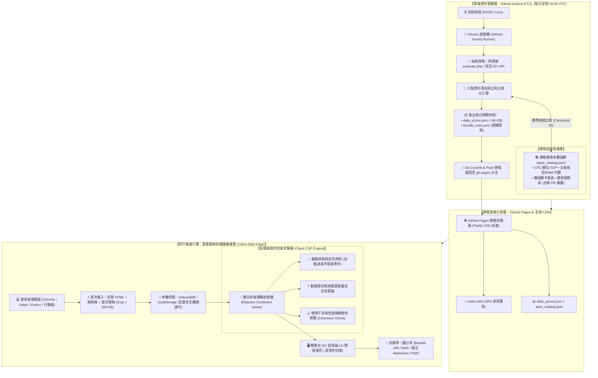

# 壹、系統架構與資料流水線設計 (System Architecture & Data Pipeline)

> **核心架構裁決**：使用者所提議的「**GitHub Pages 託管純前端 ＋ GitHub Actions 每日定時爬取報價快照 ＋ 前端離線約束求解器自組電腦**」方案，**不僅 100% 完全可行，而且是目前開源公民科技與 PC DIY 社群中最優雅、高可用且永久零主機維運成本（$0/month TCO）的極致架構典範**。

---

## 一、系統架構全景拓撲 (System Architecture Topology)

整個系統採用**端到端解耦（Decoupled Pipeline）**與**運算全面下沉用戶端（Client-Edge Computing）**設計：



---

## 二、關注點分離：報價高頻變動 vs 規格低頻變動 (Separation of Concerns)

傳統爬蟲自組電腦系統之所以容易崩潰或難以維護，核心痛點在於「**將價格與硬體規格混在一起爬取**」：
- **通路報價（High-frequency, Volatile）**：每天甚至每小時都在變動，字串極其混亂（例如原價屋品名混雜「贈品送完為止」、「現折500」、「限整組搭機」）。
- **硬體物理規格（Low-frequency, Immutable）**：CPU 是 AM5 腳位、主機板是 M-ATX、記憶體是 DDR5、顯卡長度是 304mm——這些物理屬性自出廠到停產**永不改變**。

因此，本架構採取**雙軌解耦本體論**：

| 資料維度 | 檔案路徑 | 更新頻率 | 維護方式 | 檔案大小 |
| :--- | :--- | :--- | :--- | :--- |
| **硬體規格本體庫** | `data/spec_catalog.json` | 數週至數月（新硬體發表時） | 開源社群透過 PR 共同維護標準規格 | ~120 KB (Gzip: ~28 KB) |
| **通路每日報價快照** | `data/daily_prices.json` | 每日一次（凌晨自動化） | GitHub Actions 排程爬蟲自動抽取並比對 | ~80 KB (Gzip: ~18 KB) |
| **搭機促銷規則庫** | `data/promotions.json` | 每日一次 | 爬蟲自動萃取「限搭機/任搭折」關鍵字 | ~15 KB (Gzip: ~4 KB) |

### 核心掛接機制：規格指紋與 `canonical_id`
爬蟲程式在解析原價屋字串時，不嘗試去猜測所有硬體參數，而是透過「**正則正規化別名比對（Alias Pattern Matching）**」，將通路商品綁定至標準規格庫的 `canonical_id`：

```json
// spec_catalog.json (由開源社群維護的精準物理規格)
{
  "mb_b650m_gaming_x_ax": {
    "canonical_id": "mb_b650m_gaming_x_ax",
    "category": "motherboard",
    "brand": "Gigabyte",
    "model": "B650M GAMING X AX",
    "aliases": ["B650M GAMING X AX", "技嘉 B650M GAMING X AX"],
    "specs": {
      "socket": "AM5",
      "chipset": "AMD B650",
      "form_factor": "M-ATX",
      "memory_type": "DDR5",
      "memory_slots": 4,
      "max_memory_gb": 192,
      "pcie_x16_slots": 1,
      "m2_slots": 2,
      "sata_ports": 4,
      "vrm_phases": 6,
      "tdp_budget_recommend": 170
    }
  }
}
```

```json
// daily_prices.json (GitHub Actions 每日產出的輕量報價)
{
  "updated_at": "2026-10-08T03:15:00Z",
  "vendor": "coolpc",
  "items": {
    "mb_b650m_gaming_x_ax": {
      "price": 4690,
      "in_stock": true,
      "raw_title": "技嘉 B650M GAMING X AX(M-ATX/Realtek 2.5G+Wi-Fi 6E/註冊五年)6+2+1相電源【任搭折$200】",
      "bundle_condition": "combo_discount_200"
    }
  }
}
```

---

## 三、GitHub Actions 爬蟲管線與排程防護 (ETL Workflow)

### 1. 排程時間與執行成本
- **排程時間**：每天 UTC 03:00（台灣時間 11:00 AM）。
  - *原因*：台灣實體零售通路（原價屋、欣亞）多於上午 10:30~11:00 門市開工時更新當日報價單，此時抓取能取得最新鮮的牌價，且避開凌晨備份期。
- **免費配額消耗精算**：
  - 公開倉庫（Public Repo）：**GitHub Actions 分鐘數 100% 免費無上限**。
  - 單次 Python 爬蟲執行時間：約 **18 ~ 25 秒**。
  - 即使在私有倉庫（每月 2,000 分鐘配額），每月僅消耗約 $30 \times 0.5 = 15$ 分鐘（佔比僅 0.75%）。

### 2. 生產級 GitHub Actions Workflow 腳本 (`.github/workflows/update_prices.yml`)

```yaml
name: Daily PC Hardware Price Crawler

on:
  schedule:
    # 每天台灣時間 11:15 AM (UTC 03:15) 自動執行
    - cron: '15 3 * * *'
  workflow_dispatch: # 支援在 GitHub 網頁上手動一鍵觸發

permissions:
  contents: write

jobs:
  crawl-and-update:
    runs-on: ubuntu-latest
    steps:
      - name: Checkout Repository
        uses: actions/checkout@v4
        with:
          fetch-depth: 1

      - name: Set up Python
        uses: actions/setup-python@v5
        with:
          python-version: '3.11'
          cache: 'pip'

      - name: Install Dependencies
        run: |
          pip install requests beautifulsoup4 pydantic

      - name: Run Crawler & Spec Matcher
        run: |
          python scripts/crawler_coolpc.py

      - name: Commit & Push Price Snapshot
        run: |
          git config --global user.name "github-actions[bot]"
          git config --global user.email "github-actions[bot]@users.noreply.github.com"
          git add data/daily_prices.json data/promotions.json data/unmatched_items.log
          
          # 檢查是否有實際變動，避免空 Commit
          if git diff --staged --quiet; then
            echo "No price changes detected today."
          else
            git commit -m "chore(data): auto-update hardware prices $(date -u +'%Y-%m-%d')"
            git push
          fi
```

### 3. 反爬蟲防禦與優雅降級 (Resilience & Anti-Bot Protection)
1. **單次請求，絕不高頻**：每日僅發起 1 次 HTTP GET 請求獲取靜態頁面，總頻寬 $< 150\text{ KB}$，對零售商伺服器負載為微秒級。
2. **客製化合法識別標頭**：
   ```python
   headers = {
       "User-Agent": "OpenPCBuilder-Taiwan-OpenData/1.0 (+https://github.com/username/open-pc-builder)",
       "Accept": "text/html,application/xhtml+xml,application/xml;q=0.9,*/*;q=0.8",
       "Accept-Language": "zh-TW,zh;q=0.9,en;q=0.8",
   }
   ```
3. **熔斷保護（Circuit Breaker）**：
   - 若通路線上估價單出現驗證碼阻擋（HTTP 403/429）或網頁結構突變，爬蟲自動終止並保留**前一日有效快照**，絕不覆寫空白檔案，確保前端永遠可正常展示與試算。
   - 將無法辨識的商品自動記錄至 `data/unmatched_items.log`，方便社群成員發起 PR 擴充別名字典。
