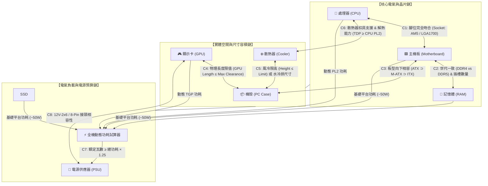

# 貳、硬體相容性約束求解引擎 (Hardware Compatibility Constraint Engine)

> **演算法核心**：將電腦 DIY 零組件的物理、電氣與尺寸相容性，形式化為純前端毫秒級執行的**約束滿足問題（Constraint Satisfaction Problem, CSP）**。使用者可以從**任何一個零組件**（CPU、主機板、顯示卡、甚至外觀導向的機殼）開始挑選，狀態機即時雙向傳播約束，動態過濾並標記不相容選項。

---

## 一、形式化數學模型與約束滿足圖譜 (Formal CSP Model)

在純前端中，我們將使用者目前的自組清單定義為一個狀態物件：
$$\text{State} = \{ x_i \mid i \in \{\text{cpu}, \text{mb}, \text{ram}, \text{gpu}, \text{cooler}, \text{ssd}, \text{case}, \text{psu}\} \}$$
其中每個未選變數的值域為該類別的全體零件集合 $D_i$。



---

## 二、六大維度約束規則矩陣 (Six Constraint Dimensions)

### 1. CPU ⟷ 主機板：腳位與晶片組世代 (Socket Compatibility)
* **硬約束 (Hard Block)**：
  - CPU 的 `socket` 必須**完全等於**主機板的 `socket`。
  - 例如：AMD Ryzen 9 7900X (`AM5`) 與 Intel Z790 (`LGA1700`) 互斥。當選定 AM5 CPU 時，主機板選單中所有 LGA1700/LGA1851/AM4 主機板**直接變灰或隱藏**。
* **軟性警示 (Soft Warning)**：
  - **BIOS 跨代相容**：例如 B650 主機板搭配最新 Ryzen 9000 系列，提示「⚠️ 此主機板出廠可能需更新 BIOS 才能點亮，請確認具備 BIOS Flashback 免 CPU 刷機功能」。
  - **供電過載警示**：低階入門 H610 主機板（供電 $\le 5$ 相）搭配 Intel Core i9-14900K，提示「⚠️ 主機板供電偏弱，在高負載下 CPU 可能會降頻運作」。

### 2. 主機板 ⟷ 記憶體：代數、插槽與容量 (RAM Compatibility)
* **硬約束 (Hard Block)**：
  - 記憶體類型 `memory_type`（DDR4 或 DDR5）必須**絕對吻合**主機板所支援的記憶體類型。
  - 挑選的支數 $\le$ 主機板插槽數 `memory_slots`（如 Mini-ITX 主板通常僅有 2 條 DIMM 插槽，若選 4 支包裝直接阻斷）。
* **容量上限**：
  - 總容量（GB）$\le$ 主機板規格 `max_memory_gb`（如 64GB / 128GB / 192GB）。

### 3. 機殼 ⟷ 主機板：板型尺寸層級包含鏈 (Form Factor Inclusions)
機殼對主機板的支援具有嚴格的**幾何包含關係**：
$$\text{E-ATX Case} \supset \text{ATX Case} \supset \text{M-ATX Case} \supset \text{Mini-ITX Case}$$

| 若選定之機殼尺寸 | 可選之主機板板型 | 排除之主機板板型 |
| :--- | :--- | :--- |
| **E-ATX 巨型機殼** | E-ATX, ATX, M-ATX, Mini-ITX | 無 |
| **ATX 標準中塔機殼** | ATX, M-ATX, Mini-ITX | E-ATX |
| **M-ATX 緊湊型機殼** | M-ATX, Mini-ITX | E-ATX, ATX |
| **Mini-ITX 迷你機殼** | Mini-ITX | E-ATX, ATX, M-ATX |

> *反向約束亦然*：若使用者先挑了一塊標準 ATX 主機板，則機殼選單中所有的 M-ATX 專用小機殼與 ITX 迷你便當盒機殼立即被標記為「❌ 無法容納 ATX 主機板」。

### 4. 機殼 ⟷ 顯示卡：物理長度與厚度干涉 (GPU Physical Clearance)
* **硬約束 (Hard Block)**：
  $$\text{GPU.length\_mm} \le \text{Case.max\_gpu\_length\_mm}$$
  - 例如：華碩 TUF RTX 4080 Super 長度為 $348\text{ mm}$，若使用者選取小機殼（如顯卡限長 $320\text{ mm}$），系統立即標記衝突：「❌ 顯卡長度超標（348mm > 機殼上限 320mm，超出 28mm）」。
* **水冷厚度扣除連鎖計算**：
  - 若機殼**前置安裝** 240/360 水冷排（厚度通常為 $27\text{ mm}$ 冷排 ＋ $25\text{ mm}$ 風扇 $\approx 52\text{ mm}$），機殼可用顯卡空間動態縮減：
    $$\text{Effective\_GPU\_Clearance} = \text{Case.max\_gpu\_length\_mm} - 52\text{ mm}$$

### 5. 散熱器 ⟷ CPU / 機殼：扣具、風冷限高與水冷排相容 (Cooling Clearance)
* **風冷散熱器（Air Cooler）**：
  $$\text{Cooler.height\_mm} \le \text{Case.max\_cpu\_cooler\_height\_mm}$$
  - 例如雙塔旗艦利民 PA120 高度 $157\text{ mm}$，若搭配限高 $150\text{ mm}$ 之機殼，側蓋無法蓋上，判定硬性阻斷。
* **一體式水冷（AIO Liquid Cooler）**：
  - 冷排規格（120mm / 240mm / 280mm / 360mm / 420mm）必須包含於機殼之頂部、前部或側邊支援清單：
    $$\text{Cooler.radiator\_size} \in \text{Case.supported\_radiators}$$
* **扣具支援**：
  - 散熱器標示之扣具規格必須包含當前 CPU 的 Socket。

### 6. 電源供應器 (PSU) ⟷ 全機總功耗與接頭 (Power & Connectors)
* **動態功耗預算演算法 (Power Budgeting)**：
  $$P_{\text{baseline}} = 50\text{ W} \quad (\text{主機板晶片組 } 15\text{W} + \text{DDR5 雙通 } 10\text{W} + \text{NVMe SSD } 10\text{W} + \text{風扇/RGB } 15\text{W})$$
  $$P_{\text{load}} = P_{\text{CPU\_PL2}} + P_{\text{GPU\_TGP}} + P_{\text{baseline}}$$
  $$P_{\text{recommended}} = \text{Math.ceil}\left(\frac{P_{\text{load}} \times 1.25}{50}\right) \times 50 \quad (\text{以 50W 為階梯向上取整})$$
* **電源分級裁決**：
  - **危險阻斷（紅色標籤）**：$\text{PSU.wattage} < P_{\text{load}}$（滿載必定觸發 OCP 過載保護斷電）。
  - **餘量偏緊（黃色預警）**：$P_{\text{load}} \le \text{PSU.wattage} < P_{\text{recommended}}$（建議升級瓦數以維持高轉換效率與靜音）。
  - **健康充裕（綠色徽章）**：$\text{PSU.wattage} \ge P_{\text{recommended}}$。
* **ATX 3.0 / PCIe 5.0 12V-2x6 接頭檢驗**：
  - 若所選顯卡包含 RTX 4070 Ti Super / 4080 / 4090 等高階 16-pin 顯卡，且選用之電源為舊款 ATX 2.4（無原生 12V-2x6 線材），提示「⚠️ 需使用顯卡附贈之雙 8-Pin 轉接線，建議選購原生 ATX 3.0 電源」。

---

## 三、純前端 TypeScript 約束求解器核心實作代碼

以下代碼展示如何在純瀏覽器端（Zero Backend Dependency）、耗時不到 1 毫秒內完成全域相容性過濾：

```typescript
// types/hardware.ts
export type SocketType = 'AM4' | 'AM5' | 'LGA1700' | 'LGA1851';
export type FormFactor = 'E-ATX' | 'ATX' | 'M-ATX' | 'Mini-ITX';
export type MemoryType = 'DDR4' | 'DDR5';

export interface BuildSelection {
  cpu?: HardwareItem;
  motherboard?: HardwareItem;
  ram?: HardwareItem;
  gpu?: HardwareItem;
  cooler?: HardwareItem;
  case?: HardwareItem;
  psu?: HardwareItem;
  ssd?: HardwareItem;
}

export interface CompatibilityResult {
  compatible: boolean;
  reasons: string[]; // 衝突原因描述
  warnings: string[]; // 軟性警示
}

// core/constraintEngine.ts
export class HardwareConstraintEngine {
  // 板型容納層級權重：值越大代表體積越大
  private static formFactorHierarchy: Record<FormFactor, number> = {
    'E-ATX': 4,
    'ATX': 3,
    'M-ATX': 2,
    'Mini-ITX': 1
  };

  /**
   * 判定特定候選零件是否能加入目前已選的清單中
   */
  public static validateItem(
    candidate: HardwareItem,
    current: BuildSelection
  ): CompatibilityResult {
    const reasons: string[] = [];
    const warnings: string[] = [];

    // 1. CPU 與 主機板 腳位檢驗
    if (candidate.category === 'motherboard' && current.cpu) {
      if (candidate.specs.socket !== current.cpu.specs.socket) {
        reasons.push(`主機板腳位 (${candidate.specs.socket}) 與已選 CPU (${current.cpu.specs.socket}) 不相容`);
      }
    }
    if (candidate.category === 'cpu' && current.motherboard) {
      if (candidate.specs.socket !== current.motherboard.specs.socket) {
        reasons.push(`CPU 腳位 (${candidate.specs.socket}) 與已選主機板 (${current.motherboard.specs.socket}) 不相容`);
      }
    }

    // 2. 主機板 與 RAM 記憶體代數檢驗
    if (candidate.category === 'ram' && current.motherboard) {
      if (candidate.specs.memory_type !== current.motherboard.specs.memory_type) {
        reasons.push(`記憶體世代 (${candidate.specs.memory_type}) 與主機板 (${current.motherboard.specs.memory_type}) 針腳防呆口不相容`);
      }
    }
    if (candidate.category === 'motherboard' && current.ram) {
      if (candidate.specs.memory_type !== current.ram.specs.memory_type) {
        reasons.push(`主機板只支援 (${candidate.specs.memory_type})，與已選記憶體 (${current.ram.specs.memory_type}) 衝突`);
      }
    }

    // 3. 機殼 與 主機板 幾何容積檢驗
    if (candidate.category === 'case' && current.motherboard) {
      const mbRank = this.formFactorHierarchy[current.motherboard.specs.form_factor as FormFactor];
      const maxCaseRank = this.formFactorHierarchy[candidate.specs.max_mb_form_factor as FormFactor];
      if (mbRank > maxCaseRank) {
        reasons.push(`機殼上限僅支援至 ${candidate.specs.max_mb_form_factor}，無法裝入 ${current.motherboard.specs.form_factor} 主機板`);
      }
    }
    if (candidate.category === 'motherboard' && current.case) {
      const mbRank = this.formFactorHierarchy[candidate.specs.form_factor as FormFactor];
      const maxCaseRank = this.formFactorHierarchy[current.case.specs.max_mb_form_factor as FormFactor];
      if (mbRank > maxCaseRank) {
        reasons.push(`此主機板尺寸 (${candidate.specs.form_factor}) 超出已選機殼支援上限 (${current.case.specs.max_mb_form_factor})`);
      }
    }

    // 4. 機殼 與 顯卡 長度物理干涉
    if (candidate.category === 'gpu' && current.case) {
      if (candidate.specs.length_mm > current.case.specs.max_gpu_length_mm) {
        reasons.push(`顯卡長度 (${candidate.specs.length_mm}mm) 超出機殼最大限長 (${current.case.specs.max_gpu_length_mm}mm)`);
      }
    }
    if (candidate.category === 'case' && current.gpu) {
      if (current.gpu.specs.length_mm > candidate.specs.max_gpu_length_mm) {
        reasons.push(`機殼顯卡限長僅 ${candidate.specs.max_gpu_length_mm}mm，無法容納長度 ${current.gpu.specs.length_mm}mm 之顯卡`);
      }
    }

    // 5. 散熱器 風冷限高 或 水冷排尺寸檢驗
    if (candidate.category === 'cooler' && current.case) {
      if (candidate.specs.cooling_type === 'air') {
        if (candidate.specs.height_mm > current.case.specs.max_cpu_cooler_height_mm) {
          reasons.push(`風冷塔散高度 (${candidate.specs.height_mm}mm) 超出機殼散熱器限高 (${current.case.specs.max_cpu_cooler_height_mm}mm)`);
        }
      } else if (candidate.specs.cooling_type === 'liquid') {
        const supportedRad = current.case.specs.supported_radiators as number[];
        if (!supportedRad.includes(candidate.specs.radiator_size)) {
          reasons.push(`機殼不支援 ${candidate.specs.radiator_size}mm 水冷排安裝`);
        }
      }
    }

    // 6. 電源瓦數與功率試算
    if (candidate.category === 'psu') {
      const totalLoad = this.calculateEstimatedTdp(current);
      if (candidate.specs.wattage < totalLoad) {
        reasons.push(`電源瓦數 (${candidate.specs.wattage}W) 低於目前整機預估滿載功耗 (${totalLoad}W)，有斷電風險`);
      } else if (candidate.specs.wattage < totalLoad * 1.25) {
        warnings.push(`建議選購至少 ${Math.ceil((totalLoad * 1.25) / 50) * 50}W 電源以保留安全冗餘`);
      }
    }

    return {
      compatible: reasons.length === 0,
      reasons,
      warnings
    };
  }

  /**
   * 預估整機峰值功耗
   */
  public static calculateEstimatedTdp(selection: BuildSelection): number {
    let power = 50; // 平台基本開銷 (主板 + RAM + SSD + 風扇)
    if (selection.cpu) power += (selection.cpu.specs.tdp_pl2 || 125);
    if (selection.gpu) power += (selection.gpu.specs.tgp || 200);
    if (selection.cooler?.specs.cooling_type === 'liquid') power += 15; // 水泵功耗
    return power;
  }
}
```
