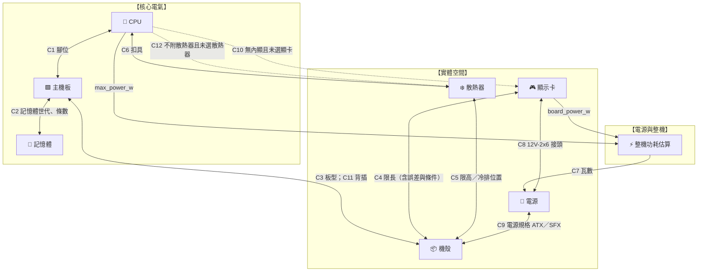

# 貳、硬體相容性約束求解引擎 (Hardware Compatibility Constraint Engine)

> **演算法核心**：把零組件的物理、電氣與尺寸相容性寫成**宣告式約束**，在瀏覽器端即時求解。使用者可以從任何零件開始挑選；每次選擇後，引擎檢查候選零件與已選零件，並做**前向檢查**，避免使用者走進「之後怎麼選都不相容」的死路。
>
> 2026-10 依 [設計審查](06-design-review.md) 與 [規格庫 schema](07-spec-catalog-schema.md) 修訂。主要改動：
> - 檢查結果改為四種：通過、警告、不通過、未知；
> - 規格缺漏時回傳「未知」，不再以預設值代替；
> - 品名來源的近似值（顯卡長度只到公分）在誤差範圍內給警告，不硬性阻斷；
> - 新增電源規格↔機殼、無內顯 CPU、背插、外接顯卡、散熱器扣具等約束。

---

## 一、模型與約束圖譜

使用者目前的配單是一個部分指派：
$$\text{Selection} = \{ x_i \mid i \in \{\text{cpu}, \text{motherboard}, \text{ram}, \text{gpu}, \text{cooler}, \text{ssd}, \text{case}, \text{psu}\} \}$$
未選類別的值域 $D_i$ 是規格庫中該類別的所有型號。



### 檢查結果

| 結果 | 意義 | UI 呈現 |
| :-- | :-- | :-- |
| `fail` | 確定不相容（裝不進去、腳位不合） | 候選項灰色、說明原因；已選時列為衝突 |
| `warn` | 可能有問題：邊界情況、特定配置下不相容、建議升級 | 黃色提示，不阻擋 |
| `unknown` | 規格庫缺少判斷所需欄位 | 「規格未確認」標記，不阻擋 |
| `pass` | 確定相容 | 綠色或不顯示 |

**為什麼要有 `unknown`**：PoC 顯示有些資訊品名根本沒寫，例如 Ryzen 5 5600X 沒有內顯、品名未標示。若以預設值補上（舊版的 `tdp_pl2 || 125`），會在使用者不知情的情況下給出錯誤結論。

---

## 二、約束規則

規格欄位名稱依 [`schema/catalog.schema.json`](schema/catalog.schema.json)。

### C1. CPU ⟷ 主機板：腳位
- **不通過**：`cpu.socket ≠ motherboard.socket`。例：AM5 的 Ryzen 7 9800X3D 與 LGA1851 的 Z890 主機板。
- **警告（BIOS 跨代）**：主機板的 `supported_cpu_generations` 不含該 CPU 的 `generation` 時，提示可能需要先更新 BIOS，並依 `bios_flashback` 說明是否能免 CPU 更新。這兩個欄位只能人工維護，缺少時不提示。
- 原價屋分類標籤已帶腳位（如 `AMD B650E & B650 / AM5腳位(DDR5)`），PoC 擷取率 99% 以上。

### C2. 主機板 ⟷ 記憶體：世代與條數
- **不通過**：`ram.memory_type ≠ motherboard.memory_type`（DDR4 與 DDR5 防呆缺口不同）。
- **不通過**：`ram.modules > motherboard.dimm_slots`（如 2 槽 ITX 主機板配 4 條一組）。`dimm_slots` 缺少時為 `unknown`。
- **警告**：總容量超過 `max_memory_gb`。

### C3. 主機板 ⟷ 機殼：板型

$$\text{rank}: \text{Mini-ITX}=1 < \text{M-ATX}=2 < \text{ATX}=3 < \text{E-ATX}=4$$

- **不通過**：`rank(motherboard.form_factor) > rank(case.max_mb_form_factor)`。

| 機殼最大板型 | 可裝 | 不可裝 |
| :--- | :--- | :--- |
| E-ATX | E-ATX、ATX、M-ATX、Mini-ITX | — |
| ATX | ATX、M-ATX、Mini-ITX | E-ATX |
| M-ATX | M-ATX、Mini-ITX | E-ATX、ATX |
| Mini-ITX | Mini-ITX | 其他全部 |

### C4. 顯示卡 ⟷ 機殼：限長（含誤差與條件）
- `gpu.external = true`（外接顯卡盒）直接通過。
- 比較時把雙方的 `tolerance` 相加作為誤差帶 $\varepsilon$：
  - $L_{\text{gpu}} - \varepsilon > C_{\text{case}}$ → **不通過**；
  - $L_{\text{gpu}} + \varepsilon > C_{\text{case}}$ → **警告**（邊界情況，請以原廠規格確認）；
  - 否則通過。
- 機殼間隙的 `conditions` 列出特定配置下較小的上限。顯卡超過某個條件值時給**警告**並說明條件。

**例 1（誤差帶）**：技嘉 RTX5060Ti EAGLE OC 品名寫 `22cm`（220 mm ±10），實際為 215 mm。配上限長 215 mm 的機殼：
220 − 10 = 210 ≤ 215，220 + 10 > 215 → **警告**。舊版設計會直接判定裝不下。

**例 2（條件式間隙）**：微星 RTX5080 VENTUS 3X OC（303 mm，已人工確認）配曜越 The Tower 300（最大 400 mm；裝上電源護罩時 280 mm）：
303 ≤ 400 → 不阻擋；303 > 280 → **警告**「需拆除電源護罩」。

### C5. 散熱器 ⟷ 機殼：限高與冷排
- **風冷**：`cooler.height_mm` 對 `case.cooler_clearance_mm`，比較方式同 C4。例：利民 Phantom Spirit 120 EVO 高 157 mm，配 CPU 限高 155 mm 的機殼 → 不通過。
- **一體式水冷**：`cooler.radiator_mm` 必須出現在 `case.radiator_support` 的任一位置；`radiator_support` 缺少時為 `unknown`。
- **前置冷排扣減顯卡空間**：冷排只能裝在前方時，以 `cooler.radiator_thickness_mm`（品名多有標示，如 `厚:5.2`）扣減顯卡空間，並對照機殼的 `front_radiator_installed` 條件。不再使用固定的 52 mm。

### C6. 散熱器 ⟷ CPU：扣具
- **不通過**：`cooler.sockets` 不含 CPU 腳位。
- 原價屋散熱器品名上的 `【WXZ】` 標記可能是扣具代碼，圖例確認前只保存原文（`mount_codes`），不用於判斷；`sockets` 缺少時為 `unknown`。

### C7. 電源 ⟷ 整機：瓦數
$$P_{\text{load}} = P_{\text{cpu}} + P_{\text{gpu}} + 50\,\text{W（主機板、記憶體、SSD、風扇）} + 15\,\text{W（若為水冷泵）}$$
$$P_{\text{recommended}} = \left\lceil \frac{P_{\text{load}} \times 1.25}{50} \right\rceil \times 50$$

- $P_{\text{cpu}}$ 用 `cpu.max_power_w`（Intel PL2／AMD PPT），$P_{\text{gpu}}$ 用 `gpu.board_power_w`。**任一缺少時結果為 `unknown`**，不以預設值估算。
- 未選顯卡，或顯卡是自帶電源的外接顯卡盒（`external`）時，$P_{\text{gpu}} = 0$。未選 CPU 時結果為 `unknown`。
- 顯卡功耗多為依晶片參考值推定（見 [`07`](07-spec-catalog-schema.md) 第四節對照表），此時結果標為依推定規格，提醒非公版超頻卡可能更高。
- `psu.wattage < P_load` → **不通過**（滿載超過額定輸出）。
- `P_load ≤ psu.wattage < P_recommended` → **警告**（餘量偏低）。
- 其餘通過。這是穩態估算；顯卡瞬間尖峰另由 ATX 3.x 規範處理，不在此計算。

例：Ryzen 7 9800X3D（PPT 162 W）＋ RTX5080（360 W）：$P_{\text{load}} = 572$ W，$P_{\text{recommended}} = 750$ W。

### C8. 顯示卡 ⟷ 電源：12V-2x6 接頭
- 顯卡 `power_connectors` 含 `12V-2x6` 且電源 `pcie_12v2x6 = 0` → **警告**「需使用顯卡附贈的轉接線，建議原生 ATX 3.x 電源」。
- 接頭資訊需人工維護；缺少時不提示。

### C9. 電源 ⟷ 機殼：電源規格（新增）
- **不通過**：`psu.form_factor` 不在 `case.psu_form_factors` 中。例：聯力 A4-H2O 只能裝 SFX，配 ATX 電源不通過。
- PoC 發現 ITX 機殼品名常標 `【SFX】`；未標示時規格庫標為推定值（`source: inferred`），結果照常計算但在 UI 註明「推定」。

### C10. CPU 無內顯且未選顯示卡（新增）
- 整機檢查：`cpu.igpu = false` 且未選顯示卡 → **警告**「此 CPU 沒有內顯，需搭配顯示卡才能輸出畫面」。
- 例：Ryzen 5 8400F、Core Ultra 5 225F。`igpu` 未知時不提示。

### C11. 背插主機板 ⟷ 機殼（新增）
- 主機板 `back_connect = true` 時，機殼需支援背插且 `rank(motherboard.form_factor) ≤ rank(case.back_connect_max_form_factor)`；不符 → **不通過**；機殼欄位缺少 → `unknown`。

### C12. CPU 不附散熱器且未選散熱器（新增）
- 整機檢查：`cpu.cooler_included = false` 且未選散熱器 → **警告**。

---

## 三、TypeScript 實作

### 1. 型別

```typescript
// types/catalog.ts —— 對應 schema/catalog.schema.json
export type Category = 'cpu' | 'motherboard' | 'ram' | 'gpu' | 'cooler' | 'case' | 'psu' | 'ssd';
export type Status = 'pass' | 'warn' | 'fail' | 'unknown';

export interface SpecValue<T> {
  value: T;
  tolerance?: number;
  conditions?: { value: number; when: string }[];
}

export interface Model {
  id: string;
  category: Category;
  specs: Record<string, SpecValue<any> | undefined>;
}

export type Selection = Partial<Record<Category, Model>>;

export interface Check {
  constraint: string;
  status: Status;
  message: string;
}
```

### 2. 宣告式約束

```typescript
// core/constraints.ts
import type { Category, Check, Model, Selection, SpecValue, Status } from '../types/catalog';

const RANK = { 'Mini-ITX': 1, 'M-ATX': 2, 'ATX': 3, 'E-ATX': 4 } as const;
const v = <T>(m: Model, field: string) => m.specs[field] as SpecValue<T> | undefined;
const result = (constraint: string, status: Status, message = ''): Check => ({ constraint, status, message });

/** 尺寸是否放得下：考慮雙方誤差與條件式上限。 */
function fits(constraint: string, size?: SpecValue<number>, limit?: SpecValue<number>): Check {
  if (!size || !limit) return result(constraint, 'unknown', '尺寸規格未確認');
  const eps = (size.tolerance ?? 0) + (limit.tolerance ?? 0);
  if (size.value - eps > limit.value)
    return result(constraint, 'fail', `${size.value} mm 超過上限 ${limit.value} mm`);
  if (size.value + eps > limit.value)
    return result(constraint, 'warn', `${size.value} mm 接近上限 ${limit.value} mm（誤差 ±${eps} mm），請以原廠規格確認`);
  const tighter = (limit.conditions ?? []).filter(c => size.value > c.value);
  if (tighter.length)
    return result(constraint, 'warn', tighter.map(c => `${c.when} 時上限僅 ${c.value} mm`).join('；'));
  return result(constraint, 'pass');
}

function equal(constraint: string, a?: SpecValue<string>, b?: SpecValue<string>, label = ''): Check {
  if (!a || !b) return result(constraint, 'unknown', `${label}未確認`);
  return a.value === b.value
    ? result(constraint, 'pass')
    : result(constraint, 'fail', `${label}不符：${a.value} ≠ ${b.value}`);
}

export interface PairConstraint {
  id: string;
  between: [Category, Category];
  check(a: Model, b: Model): Check;
}

export const PAIR_CONSTRAINTS: PairConstraint[] = [
  { id: 'C1', between: ['cpu', 'motherboard'], check: (c, m) => equal('C1', v(c, 'socket'), v(m, 'socket'), '腳位') },
  { id: 'C2', between: ['ram', 'motherboard'], check: (r, m) => {
      const gen = equal('C2', v(r, 'memory_type'), v(m, 'memory_type'), '記憶體世代');
      if (gen.status === 'fail') return gen;
      const n = v<number>(r, 'modules'), slots = v<number>(m, 'dimm_slots');
      if (!n || !slots) return result('C2', 'unknown', '記憶體條數或插槽數未確認');
      return n.value > slots.value ? result('C2', 'fail', `${n.value} 條超過 ${slots.value} 個插槽`) : gen;
  } },
  { id: 'C3', between: ['motherboard', 'case'], check: (m, c) => {
      const ff = v<keyof typeof RANK>(m, 'form_factor'), max = v<keyof typeof RANK>(c, 'max_mb_form_factor');
      if (!ff || !max) return result('C3', 'unknown', '板型未確認');
      return RANK[ff.value] > RANK[max.value]
        ? result('C3', 'fail', `機殼最大支援 ${max.value}，無法裝入 ${ff.value}`)
        : result('C3', 'pass');
  } },
  { id: 'C4', between: ['gpu', 'case'], check: (g, c) =>
      v<boolean>(g, 'external')?.value ? result('C4', 'pass') : fits('C4', v(g, 'length_mm'), v(c, 'gpu_clearance_mm')) },
  { id: 'C5', between: ['cooler', 'case'], check: (k, c) => {
      const type = v<string>(k, 'cooler_type')?.value;
      if (type === 'air') return fits('C5', v(k, 'height_mm'), v(c, 'cooler_clearance_mm'));
      if (type === 'aio') {
        const size = v<number>(k, 'radiator_mm'), support = v<{ sizes: number[] }[]>(c, 'radiator_support');
        if (!size || !support) return result('C5', 'unknown', '冷排尺寸或機殼冷排位未確認');
        return support.value.some(p => p.sizes.includes(size.value))
          ? result('C5', 'pass')
          : result('C5', 'fail', `機殼不支援 ${size.value} mm 冷排`);
      }
      return result('C5', 'unknown', '散熱器類型未確認');
  } },
  { id: 'C6', between: ['cooler', 'cpu'], check: (k, c) => {
      const sockets = v<string[]>(k, 'sockets'), socket = v<string>(c, 'socket');
      if (!sockets || !socket) return result('C6', 'unknown', '扣具支援未確認');
      return sockets.value.includes(socket.value)
        ? result('C6', 'pass')
        : result('C6', 'fail', `散熱器扣具不支援 ${socket.value}`);
  } },
  { id: 'C8', between: ['gpu', 'psu'], check: (g, p) => {
      const needs = v<string[]>(g, 'power_connectors')?.value.includes('12V-2x6');
      const has = v<number>(p, 'pcie_12v2x6');
      if (!needs || !has) return result('C8', 'pass');
      return has.value === 0 ? result('C8', 'warn', '電源無原生 12V-2x6，需使用轉接線') : result('C8', 'pass');
  } },
  { id: 'C9', between: ['psu', 'case'], check: (p, c) => {
      const ff = v<string>(p, 'form_factor'), allowed = v<string[]>(c, 'psu_form_factors');
      if (!ff || !allowed) return result('C9', 'unknown', '電源規格未確認');
      return allowed.value.includes(ff.value)
        ? result('C9', 'pass')
        : result('C9', 'fail', `機殼只能裝 ${allowed.value.join('／')} 電源`);
  } },
  { id: 'C11', between: ['motherboard', 'case'], check: (m, c) => {
      if (!v<boolean>(m, 'back_connect')?.value) return result('C11', 'pass');
      const ff = v<keyof typeof RANK>(m, 'form_factor'), max = v<keyof typeof RANK>(c, 'back_connect_max_form_factor');
      if (!ff || !max) return result('C11', 'unknown', '機殼是否支援背插未確認');
      return RANK[ff.value] <= RANK[max.value] ? result('C11', 'pass') : result('C11', 'fail', '機殼不支援此板型的背插主機板');
  } },
];

/** 整機層級的檢查（功耗、缺少必要零件）。 */
export function buildChecks(sel: Selection): Check[] {
  const checks: Check[] = [];
  const { cpu, gpu, cooler, psu } = sel;
  if (cpu && !gpu && v<boolean>(cpu, 'igpu')?.value === false)
    checks.push(result('C10', 'warn', '此 CPU 沒有內顯，需搭配顯示卡'));
  if (cpu && !cooler && v<boolean>(cpu, 'cooler_included')?.value === false)
    checks.push(result('C12', 'warn', '此 CPU 不附散熱器'));
  if (psu) {
    const load = estimateLoad(sel);
    const watt = v<number>(psu, 'wattage');
    if (load === null || !watt) checks.push(result('C7', 'unknown', '功耗或瓦數未確認，無法估算'));
    else if (watt.value < load) checks.push(result('C7', 'fail', `額定 ${watt.value} W 低於估計滿載 ${load} W`));
    else if (watt.value < recommended(load)) checks.push(result('C7', 'warn', `建議至少 ${recommended(load)} W`));
    else checks.push(result('C7', 'pass'));
  }
  return checks;
}

/** 任一必要功耗欄位缺少時回傳 null（未知），不以預設值估算。 */
export function estimateLoad(sel: Selection): number | null {
  if (!sel.cpu || !sel.gpu) return null;
  const cpuW = v<number>(sel.cpu, 'max_power_w'), gpuW = v<number>(sel.gpu, 'board_power_w');
  if (!cpuW || !gpuW) return null;
  const pump = sel.cooler && v<string>(sel.cooler, 'cooler_type')?.value === 'aio' ? 15 : 0;
  return cpuW.value + gpuW.value + 50 + pump;
}

export const recommended = (load: number) => Math.ceil((load * 1.25) / 50) * 50;
```

### 3. 求解：評估候選與前向檢查

```typescript
// core/engine.ts
import { PAIR_CONSTRAINTS, buildChecks } from './constraints';
import type { Category, Check, Model, Selection } from '../types/catalog';

const SEVERITY = { fail: 3, warn: 2, unknown: 1, pass: 0 } as const;
export const worst = (checks: Check[]) =>
  checks.reduce<Check['status']>((w, c) => (SEVERITY[c.status] > SEVERITY[w] ? c.status : w), 'pass');

/** 候選零件放進目前配單後的所有檢查結果。 */
export function evaluate(candidate: Model, sel: Selection): Check[] {
  const trial: Selection = { ...sel, [candidate.category]: candidate };
  const pair = PAIR_CONSTRAINTS
    .filter(c => c.between.includes(candidate.category))
    .flatMap(c => {
      const [a, b] = c.between.map(cat => trial[cat]);
      return a && b ? [c.check(a, b)] : [];
    });
  return [...pair, ...buildChecks(trial)];
}

/**
 * 前向檢查：選了 candidate 之後，哪些尚未選擇的類別會沒有任何「不是 fail」的選項。
 * 例：已選 AM5 CPU，再選 DDR4 記憶體 → 主機板類別沒有 AM5 ＋ DDR4 的選項 → 回傳 ['motherboard']。
 * 只檢查與 candidate 直接相連的類別（成對約束），成本為 |候選| × |相鄰類別值域|。
 */
export function deadEnds(candidate: Model, sel: Selection, catalog: Record<Category, Model[]>): Category[] {
  const trial: Selection = { ...sel, [candidate.category]: candidate };
  const neighbours = new Set(
    PAIR_CONSTRAINTS.filter(c => c.between.includes(candidate.category))
      .flatMap(c => c.between)
      .filter(cat => cat !== candidate.category && !trial[cat]),
  );
  return [...neighbours].filter(cat =>
    !catalog[cat].some(m => evaluate(m, trial).every(c => c.status !== 'fail')),
  );
}
```

UI 用法：
- 候選清單中每一項顯示 `worst(evaluate(item, selection))`；
- `deadEnds` 不為空的候選項加註「選了之後將沒有相容的〇〇」，並降低排序；
- 已選零件之間的衝突以 `evaluate(selected, others)` 列在估價單旁。

### 4. 效能

PoC 規模為 8 類約 1,800 個型號。列出某類別的候選時，成對檢查次數約為「候選數 × 已選零件數」，數千次以內。前向檢查最重的情況是機殼（約 425）× 顯卡（約 194），約 8 萬次比較。實作完成後需以真實資料量測；舊版「< 1 ms」的說法沒有依據，已移除。若前向檢查成為瓶頸，可改為只在游標停留或選取時計算。
