# 參、前端使用者體驗與零維運部署 (Frontend UX & Zero-Maintenance Deployment)

> **設計哲學**：貫徹開源軟體規格架構師（`oss-spec-architect`）之**五大黃金支柱**，打造極致純淨、無侵入式廣告、毫秒級響應且具備出版級美學的純前端單頁應用（SPA）。
>
> 2026-10 依 [設計審查](06-design-review.md) 修訂：相容性結果改為四種狀態並新增「未確認」配色；顯示報價日期與非官方聲明；分享連結加入版本號與 ID 轉址；部署流程加入規格庫驗證，並與每日報價流程共用部署佇列。

---

## 一、五大黃金支柱與介面規範 (The 5 Golden Pillars Implementation)

```mermaid
flowchart LR
    subgraph Header["頂部常駐導航列 (Sticky Topbar)"]
        Logo["🖥️ OpenPCBuilder TW"]
        ThemeToggle["☀️/🌙 主題切換 (預設淺色 Default Light)"]
        RepoBtn["🐙 GitHub Repo Icon (直連開源庫)"]
        CoffeeBtn["☕ Buy Me a Coffee (自定義贊助按鈕)"]
    end

    subgraph Workspace["核心自組估價工作區 (Three-Column Layout)"]
        Col1["📋 零件類別選單<br>(CPU / 主機板 / 顯卡 / 機殼...)"]
        Col2["🔍 候選商品清單<br>(動態即時相容性過濾 + 搜尋)"]
        Col3["🧾 目前估價單與功耗儀表<br>(即時總價 / 瓦數指針 / 衝突與待確認清單 / 報價日期)"]
    end

    subgraph Actions["分享與匯出操作 (Zero-Database Export)"]
        ShareURL["🔗 URL 壓縮短鏈結分享"]
        ExportPTT["📋 PTT PC_Shopping 格式匯出"]
        ExportMD["📝 Markdown 菜單複製"]
    end

    Header --> Workspace --> Actions
```



**手機版面**：寬度不足時三欄改為單欄，依序為「零件類別 → 候選清單 → 估價單」，估價單收合為底部常駐列（顯示總價與衝突數，點開展開）。候選清單改用底部抽屜（bottom sheet），避免小螢幕上的浮動視窗被虛擬鍵盤遮住。

### 1. 模型工作室風格 (Model Kit Studio) ✕ 雙軌色系 Design Tokens
* **預設視覺**：初次開啟為淺色模式，使用者切換後記住選擇。
* **視覺風格**：**風格 3【模型工作室風 (Model Kit Studio)】**。UI 帶有模型拼裝工作台（Cutting Mat / Workbench）刻度感與零件板件（Runner）微切角設計，操作伴隨精準拼裝卡扣之立體反饋。
* **色彩規範**：
  - **預設淺色模式 (Default Light)**：**【白金綠 (White-Gold-Emerald)】**──純白潔淨組裝台底色、翡翠綠通過/相容標記、奢雅金黃重點銘牌。
  - **深色模式 (Dark Mode)**：**【黑紅金 (Black-Crimson-Gold)】**──黑曜石工作台、古銅金奢華邊框與功能按鈕、猩紅穿模與碰撞高亮警示。

| Token 變數 | 淺色模式 (白金綠 White-Gold-Emerald) | 深色模式 (黑紅金 Black-Crimson-Gold) | 功用說明 |
| :--- | :--- | :--- | :--- |
| `--bg-primary` | `#FBFBF9` (溫潤白瓷工作台) | `#0C0A09` (曜石黑底 / Stone-950) | 全域背景底色 |
| `--bg-surface` | `#FFFFFF` (純白零件卡片) | `#1C1917` (黑化金屬 / Stone-900) | 零件列表與卡片背景 |
| `--border-accent` | `#D97706` (典雅金 Amber-600) | `#EAB308` (古銅金 Yellow-500) | 模型卡榫邊框與精緻金邊 |
| `--text-primary` | `#1C1917` (暖黑文字) | `#FAFAF9` (亮白文字) | 標題與核心品名文字 |
| `--text-muted` | `#78716C` (暖灰說明) | `#A8A29E` (金屬灰次要說明) | 規格次要描述與標籤 |
| `--accent-brand` | `#059669` (翡翠綠 Emerald-600) | `#EAB308` (亮金色 Yellow-500) | 主按鈕、核取標記、通電指示 |
| `--status-error` | `#DC2626` (深紅警示 Red-600) | `#EF4444` (猩紅碰撞 Red-500) | 3D 穿模衝突與幾何碰撞警告 |
| `--status-warn` | `#D97706` (琥珀金 Amber-600) | `#F59E0B` (熔岩金 Amber-500) | 供電偏緊/需刷 BIOS 預警 |
| `--status-ok` | `#10B981` (健康綠 Emerald-500) | `#34D399` (螢光綠 Emerald-400) | 完全相容/安全功耗徽章 |
| `--status-unknown` | `#64748B` (石板灰 Slate-500) | `#94A3B8` (霧灰 Slate-400) | 規格未確認（相容性結果為「未知」） |

相容性結果與配色對應：不通過 → `--status-error`；警告 → `--status-warn`；未知 → `--status-unknown`；通過 → `--status-ok`。「未知」不可用綠色或省略標記，以免使用者誤以為已確認相容。


* **防閃爍腳本 (Anti-FOUC)**：於 `index.html` 的 `<head>` 最頂部內聯原生 JS，於 CSS 載入前鎖定主題。無痕模式或封鎖網站資料時 `localStorage` 可能丟出例外，必須包在 `try` 內，失敗時使用淺色：
  ```html
  <script>
    let savedTheme = 'light';
    try { savedTheme = localStorage.getItem('theme') || 'light'; } catch (e) {}
    document.documentElement.classList.toggle('dark', savedTheme === 'dark');
  </script>
  ```

### 2. 頂部 Sticky 導航列與贊助整合
* **GitHub 倉庫 Icon 按鈕**：
  - 位置：右上角操作區。
  - 規格：常駐 Octocat 向量 SVG 圖標，點擊新分頁直達開源倉庫，附帶即時 GitHub Star 徽章。
* **Buy Me a Coffee 贊助按鈕**：
  - 統一端點：`https://www.buymeacoffee.com/<username>`。
  - 視覺：高質感黃黑相間經典配色膠囊按鈕，點擊支持開發者持續維護規格資料庫。

### 3. 報價日期與非官方聲明
* **報價日期**：估價單上方顯示「原價屋報價：2026-10-12 11:17 更新」，取自報價檔的 `fetched_at`。報價檔 `status` 為 `stale`（當日抓取失敗、沿用舊資料）或日期超過 2 天時，改用 `--status-warn` 色並提示「價格可能已變動，請以通路實際報價為準」。
* **附條件價格**：需搭配其他零件才成立的價格（如【任搭主機板】）在條件不成立時不計入總價，並在該列註明；「任搭折抵」只在整單有其他零件時扣除。
* **非官方聲明**：頁尾固定顯示「本站為非官方開源專案，與原價屋、欣亞等通路無關；價格與規格僅供參考，以通路實際報價為準」。

---

## 二、零資料庫分享與社群菜單匯出 (Zero-Backend Data Export)

自組電腦網站通常最需要「分享菜單給朋友看」或「貼到論壇請高手健檢」，傳統做法需要昂貴的後端伺服器與資料庫（PostgreSQL / Redis）來儲存配單 ID。

本專案採用**完全無伺服器之密碼學/字串壓縮 URL 方案**：

### 1. URL Hash 壓縮分享演算法 (LZ-String / Base64 URL Sharing)
使用者選好零件後，前端把清單序列化為緊湊的物件（只存型號 ID 與變體），以純客戶端演算法壓縮進網址的 Hash 中。內容帶版本號，日後格式改變時仍能解讀舊連結：

```typescript
// utils/shareUrl.ts
import LZString from 'lz-string';
import type { Category, Selection } from '../types/catalog';

interface SharePayload {
  v: 1;                                         // 分享格式版本
  items: Partial<Record<Category, string>>;     // 類別 → 型號 ID（可帶 #變體，如 case:montech:hs02-pro#white）
}

export function generateShareUrl(selection: Selection, variants: Partial<Record<Category, string>> = {}): string {
  const items: SharePayload['items'] = {};
  for (const [cat, model] of Object.entries(selection) as [Category, { id: string }][]) {
    items[cat] = variants[cat] ? `${model.id}#${variants[cat]}` : model.id;
  }
  const compressed = LZString.compressToEncodedURIComponent(JSON.stringify({ v: 1, items } satisfies SharePayload));
  return `${window.location.origin}${window.location.pathname}#/build?b=${compressed}`;
}

/** 解析分享連結。已棄用的型號依 replaced_by 轉址；找不到的型號回報給 UI 提示使用者。 */
export function parseShareUrl(
  compressed: string,
  resolve: (id: string) => { id: string } | undefined,   // 查規格庫，含 replaced_by 轉址
): { items: Partial<Record<Category, string>>; missing: string[] } | null {
  try {
    const json = LZString.decompressFromEncodedURIComponent(compressed);
    const payload = json ? (JSON.parse(json) as SharePayload) : null;
    if (!payload || payload.v !== 1) return null;
    const items: Partial<Record<Category, string>> = {};
    const missing: string[] = [];
    for (const [cat, ref] of Object.entries(payload.items) as [Category, string][]) {
      const [id, variant] = ref.split('#');
      const model = resolve(id);
      if (model) items[cat] = variant ? `${model.id}#${variant}` : model.id;
      else missing.push(id);
    }
    return { items, missing };
  } catch {
    return null;
  }
}
```

* **優勢與限制**：
  - **長期有效的條件**：型號 ID 一經發布不得改名或重用；需要更正時以 `replaced_by` 轉址（見 [`07`](07-spec-catalog-schema.md) 第三節）。型號被移除時，開啟連結會列出找不到的零件，而不是整份失效。
  - **價格以開啟當天為準**：連結只存型號，不存價格。開啟時以當日報價計算，並顯示報價日期；與分享當時的價格可能不同。
  - **隱私**：無個人資料上傳，純客戶端編碼與解碼。
  - **維運費用**：$0。

### 2. PTT PC_Shopping / 論壇標準菜單一鍵匯出
一鍵產生符合 PTT 電腦採購板規之 Markdown / BBS 文字格式：

```text
已選配備清單（由 原價煮便當 TW-bentocraft 產出，非官方）：
==================================================
【處理器】AMD R7 9800X3D【8核/16緒】                 $16,150
【主機板】技嘉 X870 GAMING X WIFI7 (ATX)             $9,490
【記憶體】威剛 32G(16G*2) D5-6000 CL30 LancerBlade   $19,099
【顯示卡】微星 RTX5080 16G VENTUS 3X OC (31cm)       $53,990
【散熱器】利民 Phantom Spirit 120 EVO (高15.7)      $1,890
【硬　碟】金士頓 KC3000 1TB Gen4                     $6,488
【機　殼】華碩 TUF Gaming GT502 Horizon (卡長40/U高16.3)  $4,690
【電　源】華碩 TUF GAMING 1000W Gold                  $4,590
==================================================
【總金額】NT$ 116,387 元（原價屋 2026-10-12 報價，現金價）
【預估功耗】572 W ｜【建議電源】750W 以上（目前 1000W，餘量充裕）
【相容性】10 項檢查：9 項通過、1 項規格未確認（散熱器扣具）
【線上配單網址】https://vaalrl.github.io/TW-bentocraft/#/build?b=...
```

---

## 三、GitHub Pages 自動構建與發布流水線 (CI/CD Deploy Workflow)

在開源倉庫的根目錄配置 `.github/workflows/deploy.yml`，任何對 `main` 分支的代碼變更或規格庫 PR 合併，先驗證規格庫，再執行 Vite 構建並部署至 GitHub Pages。

每日報價更新**不經過這個 workflow**：以 `GITHUB_TOKEN` 推送的提交不會觸發其他 workflow，所以每日報價在 `daily-prices.yml` 內自行建置與部署（見 [`01`](01-system-architecture-and-data-pipeline.md) 第三節）。兩者共用 `concurrency: pages`，且不取消進行中的部署，避免程式更新把當天的報價部署中斷：

```yaml
name: Deploy Web SPA to GitHub Pages

on:
  push:
    branches: [main]
  workflow_dispatch:

permissions:
  contents: read
  pages: write
  id-token: write

concurrency:
  group: 'pages'
  cancel-in-progress: false

jobs:
  build-and-deploy:
    environment:
      name: github-pages
      url: ${{ steps.deployment.outputs.page_url }}
    runs-on: ubuntu-latest
    steps:
      - name: Checkout Code
        uses: actions/checkout@v4

      - name: Setup Python
        uses: actions/setup-python@v5
        with:
          python-version: '3.11'

      - name: Validate spec catalog and prices
        run: |
          pip install -r requirements.txt
          python schema/validate.py --catalog data/catalog/*.json --prices data/prices/*.json

      - name: Setup Node.js
        uses: actions/setup-node@v4
        with:
          node-version: 20
          cache: 'npm'

      - name: Install Dependencies
        run: npm ci

      - name: Build Web Application
        run: npm run build

      - name: Setup Pages
        uses: actions/configure-pages@v4

      - name: Upload Artifact
        uses: actions/upload-pages-artifact@v3
        with:
          path: './dist'

      - name: Deploy to GitHub Pages
        id: deployment
        uses: actions/deploy-pages@v4
```
