# 參、前端使用者體驗與零維運部署 (Frontend UX & Zero-Maintenance Deployment)

> **設計哲學**：貫徹開源軟體規格架構師（`oss-spec-architect`）之**五大黃金支柱**，打造極致純淨、無侵入式廣告、毫秒級響應且具備出版級美學的純前端單頁應用（SPA）。

---

## 一、五大黃金支柱與介面規範 (The 5 Golden Pillars Implementation)

```mermaid
flowchart LR
    subgraph Header["頂部常駐導航列 (Sticky Topbar)"]
        Logo["🖥️ OpenPCBuilder TW"]
        ThemeToggle["☀️/🌙 主題切換 (預設淺色 Default Light)"]
        RepoBtn["🐙 GitHub Repo Icon (直連開源庫)"]
        CoffeeBtn["☕ Buy Me a Coffee (自定義贊助按鈕)"]
    end

    subgraph Workspace["核心自組估價工作區 (Three-Column Layout)"]
        Col1["📋 零件類別選單<br>(CPU / 主機板 / 顯卡 / 機殼...)"]
        Col2["🔍 候選商品清單<br>(動態即時相容性過濾 + 搜尋)"]
        Col3["🧾 目前估價單與功耗儀表<br>(即時總價 / 瓦數指針 / 衝突清單)"]
    end

    subgraph Actions["分享與匯出操作 (Zero-Database Export)"]
        ShareURL["🔗 URL 壓縮短鏈結分享"]
        ExportPTT["📋 PTT PC_Shopping 格式匯出"]
        ExportMD["📝 Markdown 菜單複製"]
    end

    Header --> Workspace --> Actions
```



### 1. 強制預設淺色模式與動態主題 Design Tokens (Default Light Mode)
* **預設視覺**：初次開啟為清爽、明亮、高清晰度的白色與淺灰底色，拒絕昏暗與閱讀疲勞。
### 1. 模型工作室風格 (Model Kit Studio) ✕ 雙軌色系 Design Tokens
* **視覺風格**：**風格 3【模型工作室風 (Model Kit Studio)】**。UI 帶有模型拼裝工作台（Cutting Mat / Workbench）刻度感與零件板件（Runner）微切角設計，操作伴隨精準拼裝卡扣之立體反饋。
* **色彩規範**：
  - **預設淺色模式 (Default Light)**：**【白金綠 (White-Gold-Emerald)】**──純白潔淨組裝台底色、翡翠綠通過/相容標記、奢雅金黃重點銘牌。
  - **深色模式 (Dark Mode)**：**【黑紅金 (Black-Crimson-Gold)】**──黑曜石工作台、古銅金奢華邊框與功能按鈕、猩紅穿模與碰撞高亮警示。

| Token 變數 | 淺色模式 (白金綠 White-Gold-Emerald) | 深色模式 (黑紅金 Black-Crimson-Gold) | 功用說明 |
| :--- | :--- | :--- | :--- |
| `--bg-primary` | `#FBFBF9` (溫潤白瓷工作台) | `#0C0A09` (曜石黑底 / Stone-950) | 全域背景底色 |
| `--bg-surface` | `#FFFFFF` (純白零件卡片) | `#1C1917` (黑化金屬 / Stone-900) | 零件列表與卡片背景 |
| `--border-accent` | `#D97706` (典雅金 Amber-600) | `#EAB308` (古銅金 Yellow-500) | 模型卡榫邊框與精緻金邊 |
| `--text-primary` | `#1C1917` (暖黑文字) | `#FAFAF9` (亮白文字) | 標題與核心品名文字 |
| `--text-muted` | `#78716C` (暖灰說明) | `#A8A29E` (金屬灰次要說明) | 規格次要描述與標籤 |
| `--accent-brand` | `#059669` (翡翠綠 Emerald-600) | `#EAB308` (亮金色 Yellow-500) | 主按鈕、核取標記、通電指示 |
| `--status-error` | `#DC2626` (深紅警示 Red-600) | `#EF4444` (猩紅碰撞 Red-500) | 3D 穿模衝突與幾何碰撞警告 |
| `--status-warn` | `#D97706` (琥珀金 Amber-600) | `#F59E0B` (熔岩金 Amber-500) | 供電偏緊/需刷 BIOS 預警 |
| `--status-ok` | `#10B981` (健康綠 Emerald-500) | `#34D399` (螢光綠 Emerald-400) | 完全相容/安全功耗徽章 |


* **防閃爍腳本 (Anti-FOUC)**：於 `index.html` 的 `<head>` 最頂部內聯 4 行原生 JS，於 CSS 載入前鎖定主題，保證重新整理 0 殘影：
  ```html
  <script>
    const savedTheme = localStorage.getItem('theme') || 'light';
    if (savedTheme === 'dark') document.documentElement.classList.add('dark');
    else document.documentElement.classList.remove('dark');
  </script>
  ```

### 2. 頂部 Sticky 導航列與贊助整合
* **GitHub 倉庫 Icon 按鈕**：
  - 位置：右上角操作區。
  - 規格：常駐 Octocat 向量 SVG 圖標，點擊新分頁直達開源倉庫，附帶即時 GitHub Star 徽章。
* **Buy Me a Coffee 贊助按鈕**：
  - 統一端點：`https://www.buymeacoffee.com/<username>`。
  - 視覺：高質感黃黑相間經典配色膠囊按鈕，點擊支持開發者持續維護規格資料庫。

---

## 二、零資料庫分享與社群菜單匯出 (Zero-Backend Data Export)

自組電腦網站通常最需要「分享菜單給朋友看」或「貼到論壇請高手健檢」，傳統做法需要昂貴的後端伺服器與資料庫（PostgreSQL / Redis）來儲存配單 ID。

本專案採用**完全無伺服器之密碼學/字串壓縮 URL 方案**：

### 1. URL Hash 壓縮分享演算法 (LZ-String / Base64 URL Sharing)
使用者選好零件後，前端直接將清單序列化為緊湊的陣列（只存 `canonical_id`），並以純客戶端演算法壓縮進網址的 Hash 中：

```typescript
// utils/shareUrl.ts
import LZString from 'lz-string';

export function generateShareUrl(selection: BuildSelection): string {
  // 僅萃取零件 ID，體積極小
  const payload = Object.entries(selection).reduce((acc, [cat, item]) => {
    if (item) acc[cat] = item.canonical_id;
    return acc;
  }, {} as Record<string, string>);

  const jsonStr = JSON.stringify(payload);
  const compressed = LZString.compressToEncodedURIComponent(jsonStr);
  
  // 生成如：https://username.github.io/pc-builder/#/build?b=N4IgdghgtgpiBc5...
  return `${window.location.origin}${window.location.pathname}#/build?b=${compressed}`;
}

export function parseShareUrl(compressed: string): Record<string, string> | null {
  try {
    const jsonStr = LZString.decompressFromEncodedURIComponent(compressed);
    return jsonStr ? JSON.parse(jsonStr) : null;
  } catch {
    return null;
  }
}
```

* **優勢**：
  - **永久有效**：只要 GitHub Pages 存在，分享鏈結永不因資料庫過期而失效。
  - **隱私安全**：完全無個人資料上傳，純客戶端本地編碼與解碼。
  - **維運費用**：$0。

### 2. PTT PC_Shopping / 論壇標準菜單一鍵匯出
一鍵產生符合 PTT 電腦採購板規之 Markdown / BBS 文字格式：

```text
已選配備清單 (由 OpenPCBuilder 台灣 產出)：
==================================================
【處理器】AMD Ryzen 7 7800X3D【8核/16緒】         $12,250
【主機板】技嘉 B650M GAMING X AX (M-ATX)          $4,690
【記憶體】威剛 32GB(16G*2) DDR5-6000 XPG Lancer    $3,199
【顯示卡】華碩 TUF-RTX4070S-O12G-GAMING (301mm)    $21,990
【散熱器】利民 Peerless Assassin 120 (157mm)      $1,350
【硬　碟】Solidigm P44 Pro 2TB M.2 PCIe 4.0        $4,299
【機　殼】Montech Air 903 MAX 黑 (顯卡400/散熱180)  $1,890
【電　源】海韻 FOCUS GX-750 ATX3 (750W/金牌)        $3,790
==================================================
【總金額】NT$ 53,458 元 (含稅)
【預估功耗】415 W ｜ 【建議電源】650W 以上 (當前配置 750W 餘量充裕)
【相容性勘驗】全機物理尺寸與針腳規格 100% 通過，無干涉衝突
【線上配單網址】https://username.github.io/pc-builder/#/build?b=...
```

---

## 三、GitHub Pages 自動構建與發布流水線 (CI/CD Deploy Workflow)

在開源倉庫的根目錄配置 `.github/workflows/deploy.yml`，任何對 `main` 分支的代碼變更或規格庫 PR 合併，均自動執行 Vite 構建並部署至 GitHub Pages：

```yaml
name: Deploy Web SPA to GitHub Pages

on:
  push:
    branches: [main]
  workflow_dispatch:

permissions:
  contents: read
  pages: write
  id-token: write

concurrency:
  group: 'pages'
  cancel-in-progress: true

jobs:
  build-and-deploy:
    environment:
      name: github-pages
      url: ${{ steps.deployment.outputs.page_url }}
    runs-on: ubuntu-latest
    steps:
      - name: Checkout Code
        uses: actions/checkout@v4

      - name: Setup Node.js
        uses: actions/setup-node@v4
        with:
          node-version: 20
          cache: 'npm'

      - name: Install Dependencies
        run: npm ci

      - name: Build Web Application
        run: npm run build

      - name: Setup Pages
        uses: actions/configure-pages@v4

      - name: Upload Artifact
        uses: actions/upload-pages-artifact@v3
        with:
          path: './dist'

      - name: Deploy to GitHub Pages
        id: deployment
        uses: actions/deploy-pages@v4
```
