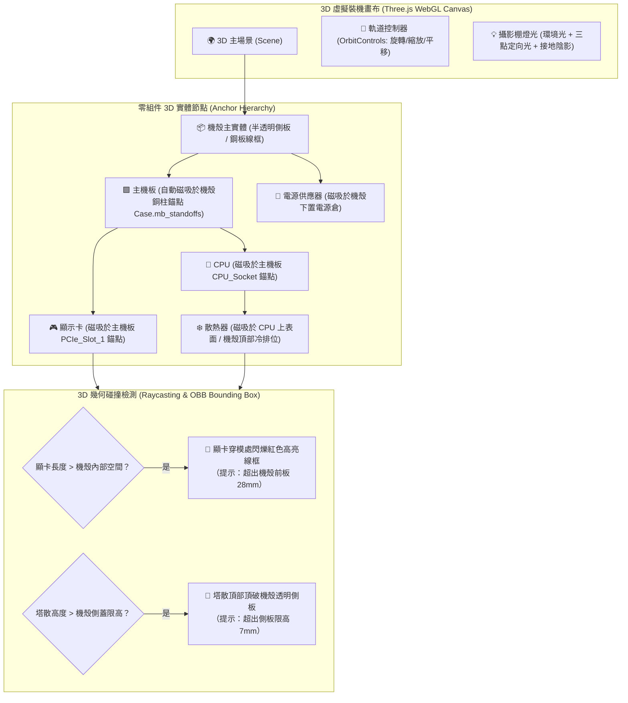

# 肆、高程度 3D 圖像化與 Three.js 虛擬裝機實驗規格 (High-Fidelity 3D Visualization & Assembly Stage)

> **設計核心**：將傳統生硬的「下拉選單 ＋ 文字警告」，升級為**「即時 3D 虛擬機殼拼裝舞台（Interactive 3D Assembly Stage）」**。  
> 利用 **Three.js / WebGL** 在瀏覽器純客戶端運行，當使用者選取硬體時，零件即時「磁吸（Snap-to-Fit）」裝入虛擬機殼；當發生硬體物理干涉（顯卡過長撞前板、塔散過高頂側蓋）時，以 **3D 幾何碰撞紅色高亮線框（Visual Collision Feedback）** 直觀反饋。

---

## 一、GitHub Pages 部署 Three.js 之可行性與工程邊界審計

### 1. 可行性判定：【100% 完全可行，零伺服器門檻】
* **運作本質**：Three.js、WebGL、WebGPU 以及 3D 模型格式（`.glb` / `.gltf`）**本質上全都是在使用者瀏覽器客戶端（Client GPU）執行的靜態資產**。
* **託管無縫相容**：GitHub Pages 是一個純靜態 Web 伺服器，對 HTML、JS Bundle、WASM 與 `.glb` 檔案具有原生支援與標準 MIME 類型對齊（`model/gltf-binary`）。
* **先例證實**：
  - Three.js 官方官方網站範例庫（`https://threejs.org/examples/`）與大量社群作品長期直接部署於 GitHub Pages（`mrdoob.github.io/three.js`）。
  - 各類純前端 Web 3D 遊戲與產品展示站（如工作區已完成之《台北狂飆》3D 遊戲）均證實 GitHub Pages 能流暢支撐 60 FPS 渲染。

### 2. 靜態部署關鍵防禦與資產輕量化標準

| 挑戰維度 | 潛在瓶頸 | 生產級工程防禦解法 |
| :--- | :--- | :--- |
| **3D 模型體積** | 傳統未壓縮 OBJ/FBX 動輒數十 MB，拖慢首次載入 | **強制採用 GLB ＋ Draco 幾何壓縮 ＋ KTX2 (Basis) 紋理壓縮**。單一零件模型體積壓制在 **100 KB ~ 800 KB**。全套主流零組件庫總體積 $< 15\text{ MB}$。 |
| **多模型並發載入** | 同時加載多個零組件造成網路瀑布流阻塞 | **按需漸進式流式載入（Lazy Progressive Streaming）**：未選取的零件不載入 3D 模型；首次僅載入當前選中之零組件。 |
| **行動端與低階裝置效能** | 無獨立顯卡之後段設備可能卡頓或掉幀 | **雙軌動態切換（Adaptive LOD & Fallback）**：<br>1. 高階桌面：完整 PBR 材質、動態陰影、抗鋸齒。<br>2. 輕量/行動端：無光影 Flat Shading 或降級為 2D 向量拓撲圖。 |
| **快取利用率** | 每次重新整理重複下載 3D 模型浪費流量 | 利用 Fastly CDN 靜態快取 ＋ 瀏覽器 `CacheStorage` / `IndexedDB` 快取 GLB 二進位數據，實現二次造訪 0ms 本機極速讀取。 |

---

## 二、3D 虛擬裝機舞台架構 (Interactive 3D Assembly Stage)



---

## 三、高程度圖像化的三大核心視覺體驗

### 1. 錨點磁吸拼裝系統 (Snap-to-Mount Anchor System)
每個 3D 模型皆定義標準化的**局部空間座標錨點（Transform Anchors）**：
- **機殼模型 (`case.glb`)**：
  - `mb_mount`: 主機板銅柱基準點 `(x, y, z)`。
  - `psu_bay`: 電源倉槽位 `(x, y, z)`。
  - `top_radiator_mount`: 頂部冷排鎖孔座標。
- **主機板模型 (`motherboard.glb`)**：
  - `socket_center`: CPU 核心插槽位置。
  - `pcie_slot_1`: 第一條 PCIe x16 插槽中心線（顯卡金手指對齊點）。
  - `dimm_slots`: 記憶體插槽位置。
- **效果**：使用者在左側選單點選零件時，3D 舞台中的硬體會以平滑的 Lerp 動畫「飛入」並精準卡入對應槽位，產生宛如組裝鋼彈/樂高的沉浸式成就感。

### 2. 殺手級功能：3D 物理干涉「穿模紅色高亮警示」
這是超越傳統純文字警告的革命性圖像化功能：
- **顯卡長度超標 (GPU Clearance Issue)**：
  - 系統取得顯卡 3D 邊界框（OBB，Oriented Bounding Box）與機殼前板邊界。
  - 若顯卡長度超出機殼內部邊界，超出的幾何體部分以 **ShaderMaterial 著色為脈衝式半透明螢光紅（Pulsing Red Mesh）**，並在畫面上延伸出一根 3D 向量標註引線：「⚠️ 超出前板 28mm，無法關閉前面板」。
- **風冷塔散過高 (CPU Cooler Clearance Issue)**：
  - 散熱器頂部突破機殼側板平面時，機殼側蓋輪廓線亮起紅色警告色，提示「⚠️ 散熱器過高，側玻璃無法安裝」。

### 3. 透視模式與爆炸圖檢視 (X-Ray & Exploded View)
- **透視模式 (X-Ray Mode)**：一鍵切換機殼外殼為半透明玻璃或低多邊形線框（Wireframe），讓使用者能 360 度無死角檢視內部風道、走線空間與插槽分佈。
- **爆炸視角 (Exploded Assembly)**：拉動滑桿，所有零件由中心沿法線方向向外等比炸開，清晰呈現「機殼 ➔ 主板 ➔ CPU ➔ 扣具 ➔ 散熱器」的層疊安裝關係。

---

## 四、前端代碼架構：Three.js 核心渲染器實現

```typescript
// viewer/PCAssemblyViewer.ts
import * as THREE from 'three';
import { GLTFLoader } from 'three/examples/jsm/loaders/GLTFLoader.js';
import { DRACOLoader } from 'three/examples/jsm/loaders/DRACOLoader.js';
import { OrbitControls } from 'three/examples/jsm/controls/OrbitControls.js';

export class PCAssemblyViewer {
  private scene: THREE.Scene;
  private camera: THREE.PerspectiveCamera;
  private renderer: THREE.WebGLRenderer;
  private controls: OrbitControls;
  private loader: GLTFLoader;

  // 零件模型掛接實體
  private caseMesh: THREE.Object3D | null = null;
  private mbMesh: THREE.Object3D | null = null;
  private gpuMesh: THREE.Object3D | null = null;
  private coolerMesh: THREE.Object3D | null = null;

  constructor(canvasContainer: HTMLElement) {
    // 1. 初始化場景與攝影機
    this.scene = new THREE.Scene();
    this.scene.background = new THREE.Color(0xf8fafc); // 預設明亮淺色底

    this.camera = new THREE.PerspectiveCamera(
      45,
      canvasContainer.clientWidth / canvasContainer.clientHeight,
      0.1,
      1000
    );
    this.camera.position.set(400, 300, 500);

    // 2. WebGL 渲染器配置
    this.renderer = new THREE.WebGLRenderer({ antialias: true, alpha: true });
    this.renderer.setSize(canvasContainer.clientWidth, canvasContainer.clientHeight);
    this.renderer.setPixelRatio(Math.min(window.devicePixelRatio, 2));
    this.renderer.shadowMap.enabled = true;
    this.renderer.shadowMap.type = THREE.PCFSoftShadowMap;
    canvasContainer.appendChild(this.renderer.domElement);

    // 3. 軌道控制器
    this.controls = new OrbitControls(this.camera, this.renderer.domElement);
    this.controls.enableDamping = true;
    this.controls.dampingFactor = 0.05;

    // 4. 攝影棚級燈光
    this.setupStudioLighting();

    // 5. 配置支援 Draco 幾何壓縮的載入器
    const dracoLoader = new DRACOLoader();
    dracoLoader.setDecoderPath('https://www.gstatic.com/draco/versioned/decoders/1.5.6/');
    this.loader = new GLTFLoader();
    this.loader.setDRACOLoader(dracoLoader);

    this.animate();
  }

  private setupStudioLighting() {
    const ambientLight = new THREE.AmbientLight(0xffffff, 0.7);
    this.scene.add(ambientLight);

    const mainLight = new THREE.DirectionalLight(0xffffff, 1.2);
    mainLight.position.set(300, 500, 300);
    mainLight.castShadow = true;
    this.scene.add(mainLight);

    const fillLight = new THREE.DirectionalLight(0x90b0ff, 0.5);
    fillLight.position.set(-300, 200, -300);
    this.scene.add(fillLight);
  }

  /**
   * 掛接並展示選取的顯示卡，若衝突則賦予紅色警示材質
   */
  public mountGPU(gpuModelUrl: string, isCollision: boolean) {
    this.loader.load(gpuModelUrl, (gltf) => {
      if (this.gpuMesh) this.scene.remove(this.gpuMesh);
      this.gpuMesh = gltf.scene;

      // 磁吸定位至主機板 PCIe 插槽錨點
      const pcieSlotAnchor = new THREE.Vector3(50, 80, 20);
      this.gpuMesh.position.copy(pcieSlotAnchor);

      if (isCollision) {
        // 覆寫為半透明紅色警告材質
        this.gpuMesh.traverse((child) => {
          if ((child as THREE.Mesh).isMesh) {
            (child as THREE.Mesh).material = new THREE.MeshStandardMaterial({
              color: 0xef4444,
              transparent: true,
              opacity: 0.85,
              wireframe: true
            });
          }
        });
      }

      this.scene.add(this.gpuMesh);
    });
  }

  private animate = () => {
    requestAnimationFrame(this.animate);
    this.controls.update();
    this.renderer.render(this.scene, this.camera);
  };
}
```

---

## 五、分階段落地路線圖 (Milestone Roadmap)

* **Phase 1 (MVP 當前基石)**：2D 視覺化卡片、真實台灣原價屋報價快照、六維 CSP 約束排除狀態機、零維運 GitHub Pages 部署。
* **Phase 2 (高程度圖像化 2.5D 尺寸比例尺)**：引入 SVG / Canvas 2D 比例尺，繪製機殼斷面圖與顯卡/塔散實體公差填充色塊（毫米級真實比例直觀對比）。
* **Phase 3 (Three.js 3D 虛擬機殼實驗沙盒)**：整合本規格書之 WebGL 畫布，引入 5 款代表性機殼與通用零件之低多邊形（Low-Poly）Draco 壓縮 GLB 模型，實現 3D 磁吸拼裝與穿模高亮警告！
