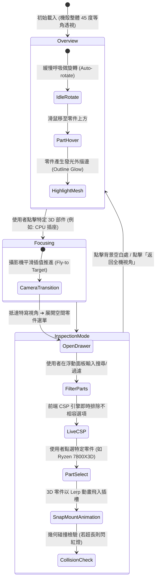
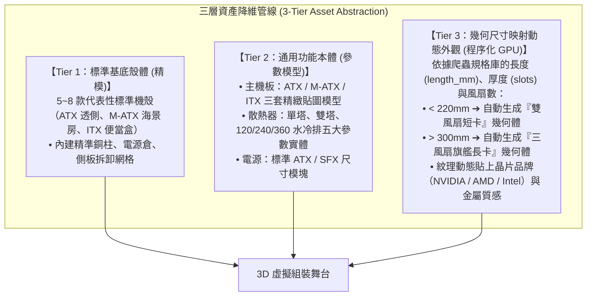

# 伍、空間互動式 3D 自組電腦架構評估：技術選型與熱區運鏡規格 (Spatial 3D PC Builder Architecture & Camera Choreography)

> **核心願景**：打破傳統電商「左邊選單、右邊清單」的二維維度，打造宛如 **Apple Vision Pro / 虛擬裝修平台** 的「空間立體主機自組體驗」──  
> 畫面中央呈現 360 度旋轉之 3D 電腦主機，使用者**直接在 3D 畫布上點擊不同部件（如透明側板、CPU 插座、PCIe 顯卡槽）**，攝影機**平滑電影級自動運鏡特寫該區域**，並在該 3D 空間座標旁彈出**支援即時搜尋、篩選與相容性排除的智慧零件抽屜**。

---

## 一、技術架構選型全景對決：Three.js 是最佳解嗎？

經過對目前 Web 3D 與前端渲染生態的深度審計，結論非常明確：
> **「純 Three.js（Vanilla）」是底層基石，但對於此專案的「最佳生產力與維護性架構」絕對是：  
> 【React 19 ＋ React Three Fiber (R3F) ＋ @react-three/drei ＋ Tailwind CSS ＋ Zustand】。**

### 五大主流 Web 3D 技術棧量化對照矩陣

| 評估維度 | ① 原生 Three.js (Vanilla TS) | ② React Three Fiber (R3F) + Drei (★★★★★ 最佳解) | ③ Babylon.js | ④ Spline / PlayCanvas | ⑤ CSS 3D / 2.5D Canvas |
| :--- | :--- | :--- | :--- | :--- | :--- |
| **底層技術** | WebGL / WebGPU | WebGL (Three.js 宣告式包裝) | WebGL / WebGPU | 專有雲端引擎 | DOM 3D Transforms |
| **GitHub Pages 相容度** | 100% 靜態相容 | 100% 靜態相容 (Vite 打包) | 100% 靜態相容 | 需依賴外部雲端 CDN | 100% 靜態相容 |
| **3D 部件點擊射線拾取 (Raycasting)** | 需手動撰寫 `Raycaster`、轉換滑鼠歸一化座標、遍歷子網格 | **原生 JSX 封裝**：直接 `<mesh onClick={...} onPointerOver={...} />` | 成熟但事件系統較冗長 | 視覺化配置，但難與自訂邏輯掛接 | 簡單 DOM 點擊，但無 3D 深度幾何 |
| **平滑運鏡 (Camera Fly-to)** | 需手動整合 GSAP/Tween.js 計算四元數旋轉與位置差補 | **Drei `<CameraControls>` 一行代碼搞定**：`controls.fitToBox(targetMesh, true)` | 內建 ArcRotateCamera 運鏡 | 預設動畫路徑，動態運算受限 | 無空間運鏡 |
| **3D 錨定浮動 UI (空間彈窗)** | 需手動以 `Vector3.project(camera)` 每幀將 3D 座標轉為 2D 螢幕像素 | **Drei `<Html>` 組件神級支援**：直接把 Tailwind 搜尋抽屜釘在 3D 零件上，自帶深度遮擋與透視縮放 | 需使用 Babylon GUI (肥大且無法用 Tailwind) | 彈窗難以完美與 DOM 響應式佈局整合 | 原生 DOM |
| **約束狀態機同步 (CSP State Sync)** | 容易陷入 3D 場景狀態與 DOM 狀態不同步的「雙重維護地獄」 | **Zustand 單一數據源**：同一個狀態變更同時觸發 3D 模型替換與 2D 零件篩選過濾 | 需自行封裝狀態機 | 極難整合複雜外掛演算法 | 無 3D 模型維護問題 |
| **打包體積與依賴** | ~600 KB | ~850 KB (Gzip 後約 220 KB) | 1.8 MB+ (較為臃腫) | 依賴閉源 Runtime | < 50 KB (但無法滿足真 3D 需求) |

### 為什麼 R3F (React Three Fiber) 是唯一終極解答？
1. **宣告式 3D（Declarative 3D）**：在 Vanilla Three.js 中，建一個發光輪廓、加一個點擊事件需要 30 行代碼；在 R3F 中只需寫宣告式標籤：
   ```tsx
   <CaseGlassPanel 
     onClick={() => handleSelectComponent('case')}
     onPointerOver={() => setHovered(true)}
   />
   ```
2. **Drei 提供的三大殺手級工具箱**：
   - `<Html>`：允許您直接將 **帶有搜尋框、過濾標籤、Tailwind CSS 的 React 零件選單**，像貼紙一樣「釘」在 3D 模型上，視角旋轉時彈窗自動跟隨，甚至還能設定 `occlude`（當主機轉到背面時，彈窗自動被機身遮擋隱藏）！
   - `<CameraControls>`：內建電影級的平滑阻尼運鏡（Smooth Damping），點擊 CPU，視角絲滑推進；點擊機殼側蓋，視角拉回大景。
   - `<Selection>` 與 `<Outline>`：滑鼠懸停在主板或顯卡上時，零件自動亮起高質感的螢光描邊，提示使用者「此處可點擊」。

---

## 二、互動流程與熱區運鏡狀態機 (Interaction & Camera Choreography)



### 1. 零件熱區（Clickable Hotspots）座標與特寫視角定義

| 3D 點擊部位 (Hit Target) | 觸發部件類別 | 攝影機目標位置 (Target LookAt) | 攝影機最佳視角距離 (Distance) | 側面板行為 |
| :--- | :--- | :--- | :--- | :--- |
| **機殼透明側板 / 鋼板** | 機殼 (PC Case) | `[0, 150, 0]` (全機中心) | $600\text{ mm}$ (大廣角 45°) | 點擊後側板執行「翻轉開門」或「透明化」動畫 |
| **主機板 CPU 插座** | 處理器 (CPU) | `[30, 220, 10]` (CPU 頂蓋中心) | $180\text{ mm}$ (近距特寫俯視) | 自動將鏡頭垂直對準主機板上半部 |
| **散熱器安裝位** | 散熱器 (Cooler) | `[30, 220, 80]` (CPU 上方空間) | $260\text{ mm}$ (側視角度，利於檢視限高) | 顯示機殼頂部/前部冷排鎖孔虛線 |
| **第一條 PCIe x16 插槽** | 顯示卡 (GPU) | `[50, 140, 20]` (顯卡金手指軸心) | $320\text{ mm}$ (側平視，直觀檢視顯卡限長) | 畫面顯示機殼前板限長紅線刻度 |
| **DIMM 記憶體插槽** | 記憶體 (RAM) | `[100, 220, 10]` (記憶體排槽) | $160\text{ mm}$ (近距特寫) | 高亮顯示插槽代數防呆缺口位置 |
| **下置式電源倉外罩** | 電源 (PSU) | `[0, 40, 0]` (機殼底部電源倉) | $280\text{ mm}$ (斜仰視視角) | 電源倉外罩半透明化，透視模組線材 |

---

## 三、模組化 3D 資產管線突破：如何解決「上百種硬體模型」的成本？

很多開發者不敢做 3D PC Builder 的最大心理障礙是：**「原價屋有幾百種顯卡、幾十種主板，難道我要全部 3D 建模嗎？」**  
**答案是：絕對不需要！工業級的最佳解法是「階層化參數模型（Procedural Parameterized Mesh）」**。



* **優勢**：
  - 全站僅需維護 **約 12 ~ 15 個高度優化的 Draco 壓縮 GLB 核心檔案**，總檔案大小控制在 **$< 6\text{ MB}$**！
  - 任何原價屋剛上市的新顯卡，只要規格庫有填寫 `length_mm: 348`，系統就會在 3D 舞台精確生成一張 $348\text{ mm}$ 的三風扇 3D 顯卡實體，完全不影響幾何碰撞檢查與視覺真實感！

---

## 四、生產級前端代碼原型：R3F 點擊運鏡與空間彈窗

以下展示如何在 React Three Fiber 中以幾十行代碼實現「點擊 3D 顯卡插槽 ➔ 視角自動運鏡特寫 ➔ 在顯卡旁彈出支援搜尋與約束過濾的零件抽屜」：

```tsx
// components/SpatialPCBuilder.tsx
import React, { useState, useRef } from 'react';
import { Canvas } from '@react-three/fiber';
import { CameraControls, Html, useGLTF, Outline, Selection, Select } from '@react-three/drei';
import * as THREE from 'three';

export function SpatialPCBuilder() {
  const cameraControlRef = useRef<CameraControls>(null);
  const [activeSlot, setActiveSlot] = useState<string | null>(null);
  const [searchQuery, setSearchQuery] = useState('');

  // 1. 平滑運鏡特寫函數
  const zoomToPart = (targetPos: THREE.Vector3, distance: number, slotName: string) => {
    setActiveSlot(slotName);
    if (cameraControlRef.current) {
      // 電影級阻尼運鏡：平滑飛向目標並對齊
      cameraControlRef.current.setLookAt(
        targetPos.x + distance * 0.8, targetPos.y + distance * 0.5, targetPos.z + distance,
        targetPos.x, targetPos.y, targetPos.z,
        true // 開啟平滑插值動畫
      );
    }
  };

  const resetCamera = () => {
    setActiveSlot(null);
    cameraControlRef.current?.setLookAt(350, 250, 400, 0, 100, 0, true);
  };

  return (
    <div className="relative w-full h-screen bg-slate-50 dark:bg-slate-900">
      <Canvas shadows camera={{ position: [350, 250, 400], fov: 45 }}>
        <ambientLight intensity={0.7} />
        <directionalLight position={[200, 400, 200]} intensity={1.2} castShadow />
        
        {/* 電影級鏡頭控制器 */}
        <CameraControls ref={cameraControlRef} minDistance={100} maxDistance={800} />

        {/* 3D 電腦主機本體 */}
        <group position={[0, 0, 0]}>
          
          {/* PCIe 顯卡點擊熱區 */}
          <mesh 
            position={[50, 120, 20]} 
            onClick={(e) => {
              e.stopPropagation();
              zoomToPart(new THREE.Vector3(50, 120, 20), 280, 'gpu');
            }}
          >
            <boxGeometry args={[280, 45, 120]} />
            <meshStandardMaterial color={activeSlot === 'gpu' ? "#3b82f6" : "#64748b"} transparent opacity={0.4} />
            
            {/* 釘在 3D 顯卡空間座標旁的 HTML 搜尋過濾抽屜！ */}
            {activeSlot === 'gpu' && (
              <Html position={[0, 40, 0]} center distanceFactor={400} className="pointer-events-auto">
                <div className="w-80 p-4 bg-white/95 dark:bg-slate-800/95 backdrop-blur-md rounded-xl shadow-2xl border border-slate-200 dark:border-slate-700">
                  <div className="flex justify-between items-center mb-2">
                    <h3 className="font-bold text-sm text-slate-800 dark:text-slate-100">🎮 選擇顯示卡 (GPU)</h3>
                    <button onClick={resetCamera} className="text-xs text-slate-400 hover:text-red-500">✕ 關閉視角</button>
                  </div>
                  <input
                    type="text"
                    placeholder="搜尋型號 (如 4070, TUF)..."
                    value={searchQuery}
                    onChange={(e) => setSearchQuery(e.target.value)}
                    className="w-full px-2.5 py-1.5 text-xs rounded-md border border-slate-300 dark:border-slate-600 mb-2 dark:bg-slate-900"
                  />
                  <div className="max-h-48 overflow-y-auto space-y-1.5 text-xs">
                    {/* 這裡掛接 CSP 約束引擎過濾後的零件列表 */}
                    <div className="p-2 rounded bg-slate-50 dark:bg-slate-700/50 hover:border-blue-500 border border-transparent cursor-pointer">
                      <div className="font-semibold text-slate-900 dark:text-slate-100">華碩 TUF-RTX4070S-O12G</div>
                      <div className="text-[10px] text-emerald-600 dark:text-emerald-400">長度 301mm ｜ 相容當前機殼 (剩餘 99mm)</div>
                      <div className="font-bold text-rose-500 mt-0.5">NT$ 21,990</div>
                    </div>
                  </div>
                </div>
              </Html>
            )}
          </mesh>

          {/* 機殼透明玻璃側板 (點擊卸下側板) */}
          <mesh 
            position={[0, 150, 110]}
            onClick={(e) => {
              e.stopPropagation();
              zoomToPart(new THREE.Vector3(0, 150, 0), 450, 'case');
            }}
          >
            <boxGeometry args={[420, 420, 4]} />
            <meshPhysicalMaterial transparent opacity={0.25} roughness={0.1} transmission={0.9} thickness={2} />
          </mesh>

        </group>
      </Canvas>
    </div>
  );
}
```

---

## 五、架構總結與決策裁決

1. **「立體電腦主機 ＋ 點擊部件運鏡 ＋ 空間彈出搜尋抽屜」是完全可行的**，且在純靜態 GitHub Pages 上即可 100% 完美運行。
2. **Three.js 是最正確的底層，但最佳工程框架是 React Three Fiber (R3F) ＋ Drei**：
   - 解決了原生 Three.js 繁雜的 Raycast 拾取。
   - Drei 的 `<Html>` 解決了 3D 空間與 Tailwind UI 彈窗的融合難題。
   - Drei 的 `<CameraControls>` 一行代碼實現電影級平滑運鏡。
3. **模型資產採用「階層化參數模型」**，僅需十餘個通用 Low-Poly 模型搭配規格長度動態調整，即可覆蓋原價屋全通路零件，徹底消滅龐大的 3D 建模維護成本。
