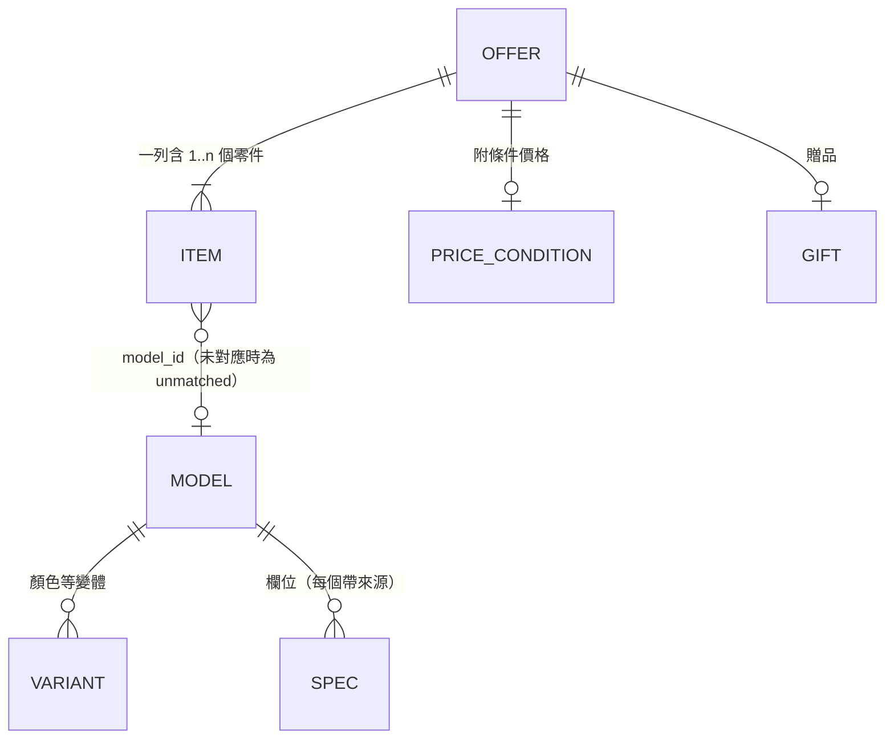

# 柒、規格庫與報價資料 Schema (Spec Catalog & Price Schema)

> **定位**：取代 `01` 第二節「`spec_catalog.json` ✕ `daily_prices.json`」的單層設計。依據 [PoC](poc/README.md) 與 [抽樣核對](poc/AUDIT-2026-10-12.md) 的實測結果重新定義。
> **機器可讀定義**：[`schema/catalog.schema.json`](schema/catalog.schema.json)、[`schema/prices.schema.json`](schema/prices.schema.json)（JSON Schema draft 2020-12）。範例在 [`schema/examples/`](schema/examples/)，驗證程式為 [`schema/validate.py`](schema/validate.py)。

---

## 一、為什麼要改：PoC 推翻的原設計假設

| `01` 原本的假設 | PoC 實測 | 本 schema 的對應 |
| :-- | :-- | :-- |
| 一列通路商品 = 一個零件 | 機殼類有 40 個「機殼＋電源／水冷／風扇」組合零件；主機板類有「主機板＋CPU」合購 | 報價列（offer）與型號（model）分開，一列可含多個零件 |
| 一個 `canonical_id` 對一個價格 | 同型號黑、白各一列、價格不同；機殼 715 列只對應約 425 個型號 | 型號 → 變體（顏色）兩層，價格掛在報價列 |
| 規格「永不改變」、由社群填寫 | 品名可自動擷取大部分規格，但顯卡長度只到公分、機殼間隙常省略條件 | 每個欄位帶「來源」與「誤差」，區分自動值與人工確認值 |
| 單一 `max_gpu_length_mm` | `顯卡長33.5(32.5)`；The Tower 300 裝上電源護罩後只剩 280 mm | 間隙欄位支援「條件式上限」 |
| `bundle_condition` 一個字串 | 任搭折抵、組裝價、需搭配指定類別、贈品、限時價並存 | 報價列拆成五種結構化欄位 |
| 缺規格時用預設值（`tdp_pl2 \|\| 125`） | 5600X 等品名不寫內顯 | 欄位缺少即「未知」，CSP 不得補預設值 |

---

## 二、檔案配置

```
data/
├── catalog/                 ← 規格庫原始檔（人工維護、PR 審查；含來源資訊）
│   ├── cpu.json
│   ├── motherboard.json
│   ├── ram.json  gpu.json  cooler.json  case.json  psu.json  ssd.json
└── prices/                  ← 每日報價（Actions 產生；每通路一檔）
    ├── coolpc.json
    └── sinya.json

public/data/                 ← 建置時產生，前端實際下載
├── catalog.min.json         ← 去掉來源資訊，只留值與近似標記
└── prices.min.json          ← 去掉原始品名
```

- **規格庫按類別分片**：降低 PR 衝突，審查時只看改到的類別。
- **報價按通路分檔**：解決 `01` 單一 `vendor` 欄位無法容納多通路的問題。前端以 `model_id` 合併各通路價格。
- **原始檔與前端檔分開**：來源、參考連結、備註只在 repo 裡供審查用，不下載到使用者瀏覽器。

### 實測體積（2026-10-12 原價屋全量，草稿規格庫）

由 `poc/to_catalog.py` 從實際頁面產生，見本文第九節。

---

## 三、資料模型



| 層級 | 存放位置 | 內容 | 變動頻率 |
| :-- | :-- | :-- | :-- |
| **型號 model** | `data/catalog/<類別>.json` | 物理與電氣規格；同型號各變體共用 | 新品上市、人工修正時 |
| **變體 variant** | 型號底下 | 顏色等不影響規格的差異 | 偶爾 |
| **報價 offer** | `data/prices/<通路>.json` | 通路的一列：價格、促銷、所含零件 | 每日 |

### 1. 型號 ID：`<類別>:<品牌>:<型號>`

例：`gpu:msi:rtx5080-16g-ventus-3x-oc`、`ram:gskill:64gb-ddr5-6000-f5-6000j3636f32gx2-rm5nrk`。

- 只允許小寫英數與 `-`、`.`，前綴必須等於類別。
- **一經發布不得改名或重用**。分享連結（`03` 的 URL Hash）只存 ID，改名就會讓舊連結失效。
- 需要更正時，舊 ID 改為 `status: deprecated` 並以 `replaced_by` 指向新 ID。轉址只能一層，驗證程式會擋串接。
- 自動產生的 ID 只是草稿。系列名為中文的型號（如芝奇「烈焰槍」「焰鋒戟」）轉成英數後可能撞號，草稿以雜湊區分，正式發布前由人工命名。
- 記憶體這類**品名後段有料號**（`｛F5-6000J3636F32GX2-RM5NRK｝`）的商品，以料號為型號鍵，避免把不同套組併成同一型號。

### 2. 欄位值：一律帶來源

```json
"length_mm": { "value": 220, "tolerance": 10, "source": "title", "note": "品名只到公分；零售商規格為 215 mm" }
```

| `source` | 意義 | 附加要求 |
| :-- | :-- | :-- |
| `title` | 通路品名擷取 | — |
| `optgroup` | 通路分類標籤（如 `AM5腳位(DDR5)`） | — |
| `inherited` | 由同型號其他列取得 | 必須有 `inherited_from` |
| `inferred` | 規則推定（如未標 SFX 的電源視為 ATX） | 待人工確認 |
| `retailer_spec` | 零售商規格表 | 必須有 `ref` 網址 |
| `vendor_spec` | 原廠規格 | 必須有 `ref` 網址 |
| `manual` | 人工判定 | 必須有 `ref` 或 `note` |

- **缺少欄位 = 未知**。CSP 遇到未知要回傳第三態，不得補預設值。
- `tolerance` 是已知誤差。品名來源的顯卡長度一律 `tolerance: 10`（實測進位誤差 +5 ~ +7 mm）。

### 3. 條件式間隙

```json
"gpu_clearance_mm": {
  "value": 400, "source": "title",
  "conditions": [
    { "value": 280, "when": "psu_shroud_installed", "source": "retailer_spec", "ref": "https://…" }
  ]
}
```

- `value` 是最寬鬆配置下的上限；`conditions` 列出特定配置下較小的上限。
- `when` 可為 `psu_shroud_installed`、`front_fan_installed`、`front_radiator_installed`、`top_radiator_installed`、`drive_cage_installed`。通路只寫括號值、沒有說明條件的（`顯卡長33.5(32.5)`），記為 `unspecified`。

### 4. 審查狀態

| `review.status` | 意義 | schema 要求 |
| :-- | :-- | :-- |
| `draft` | 自動產生、未經任何檢查 | 無 |
| `auto` | 自動產生且通過 schema 與規則檢查 | 無 |
| `verified` | 人工以原廠規格確認過 | **必須具備該類別的 CSP 必要欄位**（schema 強制） |

---

## 四、各類別欄位

標 ★ 者為 CSP 必要欄位（`verified` 時必填）。「預期來源」依抽樣核對結論：可全自動、自動後人工確認、只能人工。

| 類別 | 欄位 | 用於約束 | 預期來源 |
| :-- | :-- | :-- | :-- |
| cpu | ★`socket` | C1 腳位 | 自動（optgroup） |
| | ★`igpu` | 無內顯且未選顯卡 → 無法顯示 | 自動；品名未寫時人工 |
| | `cooler_included`、`tdp_w`、`max_power_w`、`generation` | 散熱器必選、功耗、BIOS 世代 | 部分自動 |
| motherboard | ★`socket`、★`memory_type`、★`form_factor` | C1、C2、C3 | 自動（optgroup＋品名） |
| | `chipset`、`dimm_slots`、`max_memory_gb`、`m2_slots` | 插槽與容量 | 部分自動 |
| | `back_connect` | 背插主機板需背插機殼 | 自動 |
| | `bios_flashback`、`supported_cpu_generations` | BIOS 跨代警示 | 人工 |
| ram | ★`memory_type`、★`capacity_gb`、★`modules` | C2 世代、插槽數、容量 | 自動 |
| | `speed_mts`、`height_mm` | 塔散干涉 | 速度自動、高度人工 |
| gpu | ★`length_mm` | C4 限長 | 自動後人工確認（品名只到公分） |
| | `thickness_slots`、`board_power_w`、`power_connectors` | 擴充槽、功耗、C8 接頭 | 人工 |
| | `low_profile`、`external` | 外接顯卡盒不受限長約束 | 自動 |
| cooler | ★`cooler_type` | 風冷／水冷分流 | 自動 |
| | `height_mm`（風冷）、`radiator_mm`（水冷） | C5 | 自動後人工確認 |
| | `radiator_thickness_mm` | 前置冷排扣減顯卡空間 | 自動（`厚:5.2`） |
| | `sockets`、`mount_codes` | C6 扣具 | `【WXZ】` 圖例確認前只保存原文 |
| case | ★`max_mb_form_factor`、★`gpu_clearance_mm`、★`cooler_clearance_mm`、★`psu_form_factors` | C3、C4、C5、電源規格 | 自動後人工確認條件 |
| | `radiator_support`、`psu_max_length_mm`、`expansion_slots` | 冷排位置、電源長度、顯卡厚度 | 人工 |
| | `back_connect_max_form_factor`、`included_psu_w` | 背插、內附電源 | 自動 |
| psu | ★`wattage`、★`form_factor` | C7 瓦數、電源規格 ↔ 機殼 | 瓦數自動；ATX 多為推定 |
| | `atx_version`、`pcie_12v2x6`、`efficiency`、`length_mm` | C8 接頭 | 部分自動 |
| ssd | `interface`、`form_factor`、`capacity_gb` | M.2 插槽數 | 自動 |

新增的約束欄位（`igpu`、`psu_form_factors`、`back_connect`、`external`）對應 [設計審查](06-design-review.md) 第二節列出、原設計遺漏的約束。

---

## 五、報價列（offer）

```json
{
  "offer_id": "coolpc:h3f2a9c1e",
  "category": "cpu",
  "price": 4450,
  "price_condition": { "type": "requires_category", "requires": ["motherboard"], "note": "【任搭主機板】" },
  "items": [{ "role": "main", "model_id": "cpu:amd:ryzen-5-8400f", "match": "model_key" }]
}
```

| 欄位 | 通路寫法 | 語意 |
| :-- | :-- | :-- |
| `price` | `, $4450` | 現價 |
| `list_price` | `原價$1890` | 原價 |
| `savings` | `現省$1190` | 現省金額 |
| `combo_discount` | `↓任搭290↓` | 與其他零件一起買時**再折抵**；現價本身可單買 |
| `price_condition` | `~組裝價~` → `assembly`；`【任搭主機板】` → `requires_category`；`*任搭優惠價`、`任搭價` → `unspecified` | 現價**附帶購買條件** |
| `gift` | `*送 全漢 650W(金牌)` | 贈品；可再對應到型號 |
| `valid_until` | `▼下殺到 10/31 20:00` | 限時價截止時間（+08:00） |
| `items[]` | 組合列拆出的零件 | `role`: `main`／`psu`／`aio`／`fans`／`cpu`／`ram`；未對應時 `match: unmatched` 並保留原文 |

**`offer_id`**：實測原價屋 option value 在 2,320 列中有 370 個重複，不能直接當 ID。目前以正規化品名的雜湊為主，跨日穩定性待每日排程驗證。

**`status: stale`**：抓取失敗時沿用上次成功的報價，`fetched_at` 保持上次成功時間，前端據此提示「這是 N 天前的價格」（對應設計審查第三節）。

---

## 六、CSP 如何使用這些欄位

1. **三態結果**：每條約束回傳 `pass`／`fail`／`unknown`。任一必要欄位缺少就是 `unknown`，UI 顯示「規格未確認」，不阻擋選擇。
2. **誤差帶**：有 `tolerance` 時，
   - 差距超過誤差 → `fail`（硬性阻斷）；
   - 差距在誤差內 → `warn`（「邊界情況，請以原廠規格確認」）。
   以 RTX5060Ti EAGLE（品名 220 mm ±10）配限長 215 mm 的機殼為例：原設計會直接阻斷；實際卡長 215 mm 是裝得下的。
3. **條件式間隙**：預設使用 `value`；當前配置命中某個 `when`（例如已選前置水冷且機殼有 `front_radiator_installed` 條件）時改用該條件值。命中 `unspecified` 條件時一律給 `warn`。
4. **附條件價格**：總價計算時，`price_condition` 不成立的報價列不得使用該價格（例如沒選主機板就不能用 8400F 的 4,450 元）；`combo_discount` 在整單有其他零件時才折抵。

---

## 七、驗證

`schema/validate.py` 分兩層：

| 層級 | 檢查內容 |
| :-- | :-- |
| JSON Schema | 欄位型別與列舉、每個值都有來源、各類別只允許自己的欄位、`verified` 必填欄位、`deprecated` 必有 `replaced_by`、`unmatched` 不得有 `model_id` |
| 跨檔規則 | ID 前綴與分片類別一致、ID 不重複、轉址目標存在且不得串接、報價引用的型號存在、主件類別與報價類別一致、`offer_id` 不重複 |

`schema/test_schema.py` 除了驗證範例通過，每條規則都有一個會被擋下的反例，確保 schema 不是「什麼都放行」。

建議在正式 CI 中：
- 任何改動 `data/catalog/**` 的 PR 都執行驗證，失敗則不得合併；
- 每日報價產生後先驗證，失敗則保留前一日檔案並開 issue。

---

## 八、與既有規格文件的關係

| 文件 | 需要調整之處 |
| :-- | :-- |
| `01` 第二節 | 檔案配置、`canonical_id` 範例改為本文件定義；`bundle_condition` 由第五節取代 |
| `02` 約束引擎 | `validateItem` 改為三態結果；`tdp_pl2 \|\| 125` 這類預設值移除；新增 `igpu`、PSU 規格、背插、外接顯卡約束 |
| `03` 分享連結 | 分享內容只存型號 ID；載入時依 `replaced_by` 轉址 |
| `04` / `05` 3D | 間隙以 `conditions` 呈現多段限制線，不另做碰撞計算 |

---

## 九、以真實資料驗證（2026-10-12）

`poc/to_catalog.py` 把原價屋全量品項轉成草稿規格庫與報價檔，並用本 schema 驗證：

執行紀錄：[run 38215486463](https://github.com/VaalRL/TW-bentocraft/actions/runs/38215486463)。

**結構**：2,320 列報價歸併為 **1,837 個型號**，**schema 驗證 0 錯誤**。

| 類別 | 型號數 | 有變體 | 主要欄位涵蓋率 |
| :-- | --: | --: | :-- |
| case | 425 | 311 | gpu_clearance 99%、cooler_clearance 98%、max_mb_form_factor 97%、psu_form_factors 95% |
| cooler | 301 | 132 | cooler_type 98%、mount_codes 93%、radiator_mm 52%、height_mm 43% |
| motherboard | 334 | 0 | memory_type 100%、chipset 100%、socket 99%、form_factor 99% |
| psu | 264 | 57 | wattage 100%、form_factor 100%（多為推定 ATX）、efficiency 100% |
| gpu | 194 | 3 | length_mm 97% |
| ssd | 158 | 0 | interface 100%、capacity_gb 100% |
| ram | 129 | 17 | memory_type、capacity_gb、speed_mts 100%；modules 89% |
| cpu | 32 | 0 | socket 100%、igpu 94% |

**體積**：

| 檔案 | 原始 | gzip | `01` 原估計 |
| :-- | --: | --: | :-- |
| 規格庫原始檔（8 個分片合計，含來源） | 1,206 KB | 58 KB | — |
| 前端規格庫 `catalog.min.json` | 270 KB | **31 KB** | ~120 KB／28 KB |
| 報價檔（含原始品名） | 1,016 KB | 84 KB | — |
| 前端報價檔（不含原始品名） | 542 KB | **40 KB** | ~80 KB／18 KB |

前端首次載入的資料約 71 KB（gzip），仍在 `01`「整站 < 300 KB gzip」的預算內，但報價檔約為原估計的兩倍。

**發現的資料問題**（皆由驗證或轉換流程自動標出）：

1. **規格衝突 7 筆**：同型號不同列的數值不一致。例如 Meshify 3 一列 349 mm、一列 349.5 mm；Crucial PRO 記憶體 6000 與 6400 被併為同一型號（品名無料號可區分）。衝突的型號應保持 `auto`，由人工決定。
2. **ID 碰撞 75 筆**：中文系列名轉英數後相同，草稿以雜湊區分，發布前需人工命名。
3. **通路 option value 不唯一**：2,320 列中 370 個重複，不能當 `offer_id`。
4. **電源規格多為推定**：品名未標 SFX 的電源與 ATX 機殼一律推定為 ATX（`source: inferred`），需要抽查。

---

## 十、尚未決定的事項

1. **`offer_id` 跨日穩定性**：需要每日排程連續觀察。
2. **`【WXZ】` 扣具代碼圖例**：確認後 `mount_codes` 可轉成 `sockets`，支撐 C6 約束。
3. **原始品名是否公開**：`raw_title` 只放在 repo 內的報價檔、不進前端檔；是否連 repo 都不放，需評估（設計審查第五節）。
4. **欣亞的對應方式**：需實測欣亞的資料結構後，確認 `vendor_refs` 與 `offer_id` 規則是否適用。
