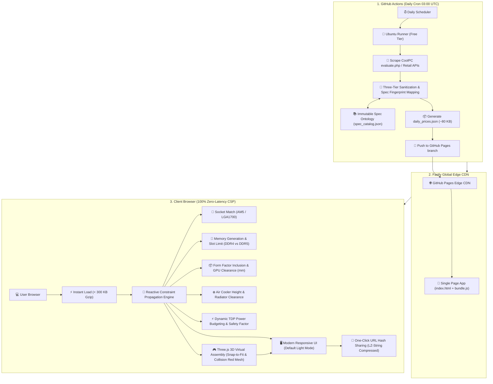
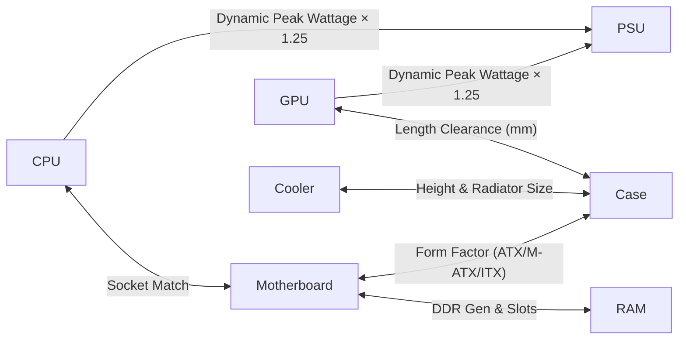

**English** | [繁體中文](README.zh-TW.md)

# ComputerboxTW (TW-bentocraft): Zero-Maintenance Open-Source 3D PC Compatibility & Pricing Engine

[](https://opensource.org/licenses/MIT)
[](https://username.github.io/TW-bentocraft/)
[](https://github.com/username/TW-bentocraft)
[](https://www.buymeacoffee.com/username)

> 🍱 **ComputerboxTW (Repo: `TW-bentocraft` / 中文品牌: 原價煮便當)** is an open-source, serverless 3D PC building estimator and hardware compatibility engine tailored for Taiwan's retail hardware ecosystem (CoolPC / Sinya).  
> 
> 🎨 **Design System & Aesthetics**:
> - **Style Archetype**: **Model Kit Studio (Gunpla / Maker Workbench)** with runner snap aesthetics and tactical precision.
> - **Default Light Theme**: **White-Gold-Emerald** (Crisp workbench white, emerald verification badges, elegant gold accents).
> - **Dark Theme**: **Black-Crimson-Gold** (Obsidian metal chassis, bronze-gold frames, crimson collision alert meshes).
> 
> It runs 100% on **client-side edge (GitHub Pages)** with **zero hosting costs**, powered by an automated daily **GitHub Actions ETL crawler**, a deterministic **Constraint Satisfaction Engine (CSP)**, and a **React Three Fiber (R3F) Spatial 3D Assembly Stage** with clickable component hot-zones and smooth camera fly-to choreography.


---

## ⚡ Core Value Proposition: Legacy Evaluators vs. OpenPCBuilder

| Dimension | Traditional Store Evaluators (CoolPC / Sinya) | Typical Commercial Builders (PCPartPicker) | **OpenPCBuilder TW (This Project)** |
| :--- | :--- | :--- | :--- |
| **Hosting & Ops Cost** | Heavy dedicated web servers ($$$) | Massive AWS cloud infrastructure ($$$$) | **$0 / month (100% Serverless GitHub Pages + Actions)** |
| **Compatibility Filtering** | None (Allows buying incompatible parts) | High (US/Global retail data focus) | **Real-time Bidirectional CSP Engine on Taiwan local parts** |
| **User Experience (UX)** | Cluttered, 1990s table, ads, no clearance checks | Ad-heavy, complex affiliate redirects | **Default Clean Light UI, dynamic dark toggle, zero ads** |
| **Menu Sharing** | Ephemeral, easily expired server sessions | Requires account login or database link | **Database-Free Compressed URL Hash sharing (LZ-String)** |
| **Open Source & Extensible** | Closed source, proprietary | Closed source commercial | **100% MIT Licensed, Community Spec Ontology PRs** |

---

## 🏗️ System Architecture Topology



---

## 🧩 Hardware Compatibility Constraint Matrix

The browser-based engine evaluates candidate parts against currently selected parts across 6 core physical and electrical dimensions:



1. **CPU ⟷ Motherboard**: Exact Socket Match (`AM4`, `AM5`, `LGA1700`, `LGA1851`). Prevents pin mismatch.
2. **Motherboard ⟷ RAM**: Strict memory generation parity (`DDR4` vs `DDR5`) and slot count enforcement.
3. **Case ⟷ Motherboard**: Form factor hierarchy enclosure (`E-ATX` $\supset$ `ATX` $\supset$ `M-ATX` $\supset$ `Mini-ITX`).
4. **Case ⟷ GPU**: Physical clearance check (`GPU.length_mm` $\le$ `Case.max_gpu_length_mm`).
5. **Cooler ⟷ CPU / Case**: Air cooler height limit (`Cooler.height_mm` $\le$ `Case.max_cooler_height_mm`) and liquid radiator mounts.
6. **PSU ⟷ Whole Build**: Dynamic peak wattage budget + 25% safety overhead + PCIe 12V-2x6 connector verification.

---

## 🚀 Quickstart & Local Development

### Prerequisites
- Node.js 20+
- Python 3.11+ (for local crawler execution)

### 1. Clone & Install Frontend
```bash
git clone https://github.com/username/open-pc-builder.git
cd open-pc-builder
npm install
```

### 2. Run Local Development Server
```bash
npm run dev
# Opens at http://localhost:5173
```

### 3. Run Test Crawler Locally
```bash
python scripts/crawler_coolpc.py
# Generates local test snapshots in data/daily_prices.json
```

---

## ☕ Support & Sponsor

If this project saved your time building PCs or helped you avoid purchasing incompatible hardware, consider buying the maintainers a coffee!

[](https://www.buymeacoffee.com/username)

---

## 📄 License
Released under the [MIT License](LICENSE).
