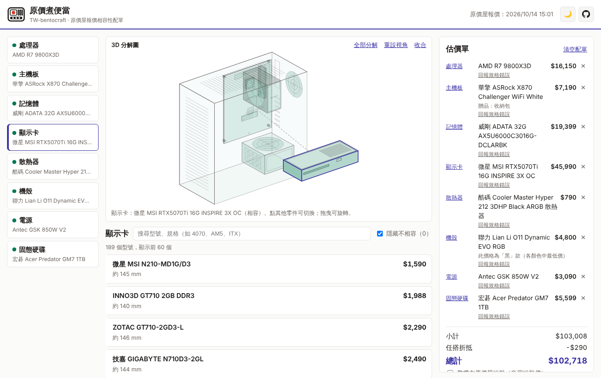
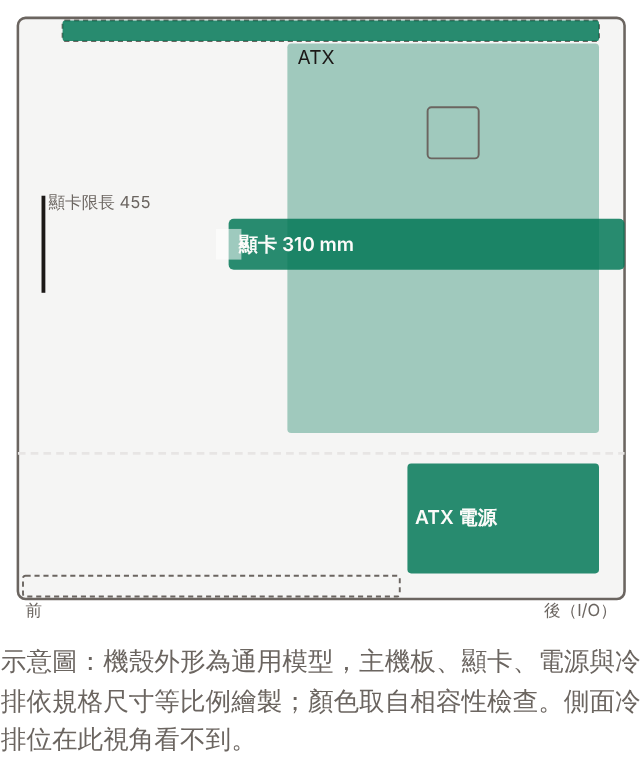

[English](README.md) | **繁體中文**

<p align="center">
  <picture>
    <source media="(prefers-color-scheme: dark)" srcset="docs/logo-dark.svg">
    
  </picture>
</p>

# 原價煮便當（TW-bentocraft）

[](https://vaalrl.github.io/TW-bentocraft/)
[](https://github.com/VaalRL/TW-bentocraft)

**用原價屋的每日報價配電腦，選零件時即時排除腳位、記憶體、尺寸與電源不相容的組合。**

👉 **https://vaalrl.github.io/TW-bentocraft/**



> 本站為非官方開源專案，與原價屋無關。價格與規格僅供參考，以原價屋公告為準。

---

## 能做什麼

- **選零件時就排除不相容的組合**：每選一個零件，其他類別的候選清單會隨之更新，不相容的預設隱藏（可取消勾選改為標示）。如果某個零件選了之後會讓其他類別一個相容選項都不剩，也會先提醒。
- **每日報價**：每天台灣時間 11:17 自動抓取原價屋估價頁。限時價、任搭折抵、「整機組裝價」這類附條件價格都分開處理，條件不成立時不計入總價。同一型號的不同顏色只列一次，取最低價並註明是哪個顏色。
- **價格走勢**：每天記錄每個型號的價格（保留 90 天）。候選清單標示與 7 天前相比的漲跌，估價單標示近 30 天最低價，現價就是近期最低時會註明。累積滿 7 天後開始顯示。
- **3D 分解圖**：等角線稿風格的通用電腦分解圖，點機殼、顯示卡、電源等部位就會開啟該類別的清單，該零件也會單獨拉出到最前方，其他零件留在機殼裡；從左側選單切換類別時也一樣。已選零件依規格尺寸等比例，顏色取自相容性檢查。可拖曳旋轉、切換「全部分解」，也能用鍵盤操作。
- **機殼示意圖與尺寸比例**：選了機殼後，以側視示意圖畫出主機板、顯卡、電源與冷排的位置，顏色取自相容性檢查；機殼外形是通用模型，零件依規格尺寸等比例繪製。另以比例尺標出顯卡長度、風冷散熱器高度與機殼上限，包括「裝上電源護罩時」這類條件式上限。

  
- **CPU 規格對決**：最多四顆 CPU 並排比較核心、時脈、快取、功耗、內顯、記憶體與 PCIe 規格，以及今天的價格與比最便宜的貴多少。列可以調整順序或隱藏，設定記在瀏覽器。規格取自 AMD、Intel 原廠規格頁並附出處。另有「算圖效能」：[Blender Open Data](https://opendata.blender.org/)（CC0）使用者跑分的中位數，每週更新，只代表多核心算圖，不代表遊戲效能。
- **分享與匯出**：一個連結就能分享整份配單（不需要帳號，資料只存在網址裡），也能一鍵複製 PTT PC_Shopping 板的菜單格式。開啟分享連結時以當天的報價計算。
- 深色模式、手機版。

### 相容性檢查

| 檢查 | 內容 |
| :-- | :-- |
| C1 CPU ⟷ 主機板 | 腳位（AM4、AM5、LGA1700、LGA1851） |
| C2 主機板 ⟷ 記憶體 | DDR4／DDR5 世代、記憶體條數不超過插槽數 |
| C3 主機板 ⟷ 機殼 | 板型（Mini-ITX ⊂ M-ATX ⊂ ATX ⊂ E-ATX） |
| C4 顯示卡 ⟷ 機殼 | 顯卡長度與機殼限長，含品名誤差與條件式上限 |
| C5 散熱器 ⟷ 機殼 | 風冷高度；一體式水冷的冷排尺寸與機殼冷排位置 |
| C6 散熱器 ⟷ CPU | 扣具是否支援該腳位 |
| C7 電源 ⟷ 整機 | 估計滿載功耗與建議瓦數 |
| C8 顯示卡 ⟷ 電源 | 16-pin（12V-2x6）顯卡配上沒有原生接頭的電源時提醒需轉接線 |
| C9 電源 ⟷ 機殼 | ATX／SFX／SFX-L 電源規格 |
| C10 | CPU 沒有內顯卻沒選顯示卡 |
| C11 背插主機板 ⟷ 機殼 | 機殼是否支援背插主機板 |
| C12 | CPU 不附散熱器卻沒選散熱器 |

每項檢查的結果分成**相容、注意、不相容、未確認**四種。「未確認」表示規格庫缺少判斷所需的資料，不代表不相容；品名上的近似值（例如顯卡長度只寫到公分）在誤差範圍內時會顯示「注意」。完整規則見 [`02`](02-hardware-compatibility-constraint-engine.md)。

## 資料從哪裡來

- **報價**：GitHub Actions 每天抓取[原價屋估價頁](https://www.coolpc.com.tw/evaluate.php)，對應到規格庫後提交 [`data/prices/coolpc.json`](data/prices/coolpc.json)，接著重新部署網站。抓取失敗時沿用前一天的報價並自動開 issue，網站上的報價日期也會標示可能已變動。
- **規格**：[`data/catalog/`](data/catalog/) 收錄約 1,700 個型號。新型號每週由自動流程從品名擷取規格、開 PR 審查；品名沒寫的值（例如功耗、記憶體插槽數、機殼冷排位置）由人工依原廠規格補上。每個值都記錄來源，推定的值在網站上會標示「依推定規格」。
- **CPU 算圖跑分**：GitHub Actions 每週下載 [Blender Open Data](https://opendata.blender.org/) 快照（CC0），整理成 [`data/benchmarks/blender-cpu.json`](data/benchmarks/)。
- 執行 `python scripts/catalog_coverage.py` 可以看各欄位的完整度。

## 發現錯誤？

規格寫錯、報價對錯型號、或相容性判斷有誤，請[開 issue 回報](https://github.com/VaalRL/TW-bentocraft/issues/new/choose)，附上型號與原廠規格頁連結會最快。想直接修改規格庫，請看 [`CONTRIBUTING.md`](CONTRIBUTING.md)。

## 支持這個專案

規格庫的資料靠人工逐一查原廠規格補上。如果這個工具幫你省了時間，歡迎[請我喝杯咖啡](https://www.buymeacoffee.com/whoami885) ☕，或幫 repo 按個星星。

---

## 本機開發

前端在 [`web/`](web/)（React ＋ Vite ＋ TypeScript），資料管線在 [`pipeline/`](pipeline/)、[`scripts/`](scripts/)。需要 Python 3.11+ 與 Node.js 22.12+。

```bash
git clone https://github.com/VaalRL/TW-bentocraft.git
cd TW-bentocraft
pip install -r requirements.txt

# 測試
python -m unittest discover -s tests -t .
(cd schema && python -m unittest test_schema)
python schema/validate.py --catalog data/catalog/*.json --prices data/prices/coolpc.json

# 前端
python scripts/build_web_data.py      # 產生 web/public/data/（規格庫與報價的前端精簡版）
cd web && npm install && npm run dev  # http://localhost:5173
npm test                              # 約束引擎測試
npm run build && npm run test:e2e     # 瀏覽器端對端測試（Playwright）
```

抓取原價屋並更新報價（需要能連到 coolpc.com.tw）：

```bash
python scripts/update_prices.py --out data/prices/coolpc.json --save-html page.html
python scripts/bootstrap_catalog.py --html page.html   # 新增規格庫中沒有的型號
```

## 設計文件

| 文件 | 內容 |
| :-- | :-- |
| [壹、系統架構與資料流水線](01-system-architecture-and-data-pipeline.md) | 每日抓取、清洗與對應流程，GitHub Actions 排程與失敗處理 |
| [貳、硬體相容性約束引擎](02-hardware-compatibility-constraint-engine.md) | C1–C12 規則、四種結果、誤差與條件式上限 |
| [參、前端體驗與部署](03-frontend-ux-and-zero-maintenance-deployment.md) | 介面規範、分享連結、PTT 匯出、GitHub Pages 部署 |
| [陸、設計審查](06-design-review.md) | 原設計的缺口與修正紀錄；[PoC](poc/README.md) 與[抽樣核對](poc/AUDIT-2026-10-12.md) |
| [柒、規格庫與報價 Schema](07-spec-catalog-schema.md) | 型號、變體、報價三層資料，欄位來源與誤差；驗證程式在 [`schema/`](schema/) |
| [一手資料來源](sources/README.md) | 原價屋資料結構、PCPartPicker 約束機制、業界標準 |

## 未來規劃

以下為規劃中、尚未實作的功能：

- 補齊顯卡佔用槽數、電源長度、記憶體高度與冷排厚度，讓機殼示意圖更準確。
- **欣亞數位**等其他通路的報價。
- 降價提醒。

[`04`](04-high-fidelity-3d-visualization-and-threejs-spec.md)、[`05`](05-3d-interactive-spatial-pc-builder-architecture.md) 規劃的擬真 3D（WebGL、真實機殼模型）暫緩：規格庫沒有機殼外部尺寸與內部配置，而且 3D 函式庫會讓網站的下載量變成約三倍。目前的 3D 分解圖以程式產生 SVG 線稿，不需額外套件；找到機殼內部尺寸的資料來源後再評估擬真版本。

## 授權

授權條款尚未決定，決定後會補上 `LICENSE`。
