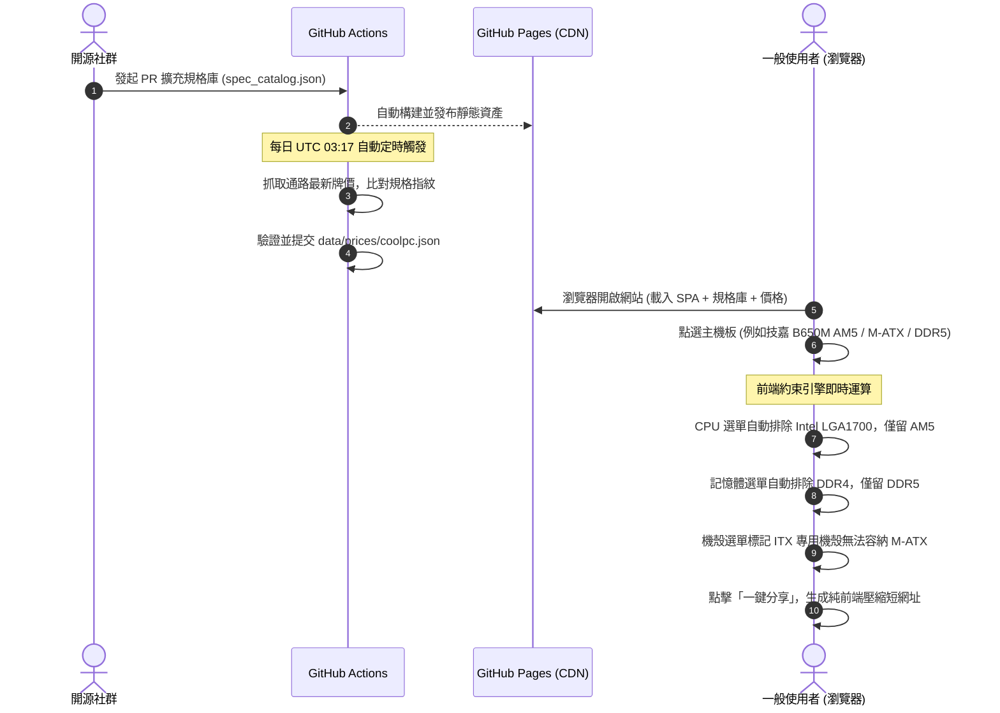

[English](README.md) | **繁體中文**

# 原價煮便當 (TW-bentocraft / ComputerboxTW)：零維運開源台灣 3D 電腦自組估價與相容性排除引擎

[](https://opensource.org/licenses/MIT)
[](https://vaalrl.github.io/TW-bentocraft/)
[](https://github.com/VaalRL/TW-bentocraft)
[](https://www.buymeacoffee.com/username)

> 🍱 **原價煮便當（ComputerboxTW / Repo: `TW-bentocraft`）** 是一個專為台灣電腦硬體零售通路（原價屋、欣亞數位）打造之**永久零主機維運成本（$0/月）**開源 3D 自組電腦估價系統與硬體相容性約束排除引擎。  
> 
> 🎨 **視覺風格與雙軌配色**：
> - **風格選型**：**風格 3【模型工作室風 (Model Kit Studio)】**──融合鋼彈/模型拼裝工作台質感、零件板件卡榫微切角與清脆組裝反饋。
> - **預設淺色系 (Default Light Mode)**：**【白金綠 (White-Gold-Emerald)】**──純白組裝台底色、翡翠綠通過/安全標記、典雅金黃重點銘牌。
> - **深色系 (Dark Mode)**：**【黑紅金 (Black-Crimson-Gold)】**──曜石黑金屬底、古銅金奢華邊框、猩紅穿模與碰撞高亮警示。
> 
> 前端 100% 部署於 **GitHub Pages**，搭配每日由 **GitHub Actions** 自動化執行的報價快照爬蟲，並在使用者瀏覽器純客戶端運行反應式**約束滿足求解器（CSP Engine）**與 **React Three Fiber (R3F) 空間 3D 裝機舞台**，達成點擊立體主機零件、電影級平滑運鏡特寫、空間懸浮搜尋抽屜，以及毫秒級動態排除不相容硬體的極致體驗。


---

## 🧭 專案研調與架構規格章節導覽

本專案規格文件由 `oss-spec-architect` 技能嚴格規範，收錄於本目錄：

1. [**壹、系統架構與資料流水線設計**](01-system-architecture-and-data-pipeline.md)：
   - GitHub Actions 每日定時爬蟲與免費運算時間精算（月耗 $<15$ 分鐘）。
   - 原價屋非結構化字串三階清洗流水線與防爬蟲安全防禦。
   - 型號規格（`data/catalog/<類別>.json`）✕ 每日報價（`data/prices/<通路>.json`）兩層資料，格式見第柒章。
   - 每日排程在同一個 workflow 內完成抓取、驗證、提交與部署；抓取失敗時沿用舊資料並自動開 issue。
2. [**貳、硬體相容性約束求解引擎**](02-hardware-compatibility-constraint-engine.md)：
   - 約束矩陣（CPU 腳位、RAM 代數與條數、板型、顯卡限長、散熱器限高/冷排/扣具、瓦數、電源規格↔機殼、無內顯 CPU、背插）。
   - 檢查結果分為通過、警告、不通過、未知；規格缺漏時回傳「未知」，品名近似值在誤差內給警告。
   - 雙向約束傳播狀態機（Reactive Constraint Propagation）與 TypeScript 核心演算法。
   - 硬性阻斷（無法開機/無法裝入）與軟性預警（供電偏弱/需更新 BIOS）分流機制。
3. [**參、前端使用者體驗與零維運部署**](03-frontend-ux-and-zero-maintenance-deployment.md)：
   - 貫徹五大黃金支柱：強制預設淺色模式（Default Light Mode）、雙軌深淺切換與防閃爍腳本。
   - 零資料庫 URL Hash 壓縮分享演算法（LZ-String），鏈結永久有效且 $0 儲存成本。
   - 一鍵匯出 PTT PC_Shopping / 論壇標準菜單格式。
   - GitHub Pages 自動化構建部署工作流（`.github/workflows/deploy.yml`）。
4. [**肆、高程度 3D 圖像化與 Three.js 虛擬裝機實驗規格**](04-high-fidelity-3d-visualization-and-threejs-spec.md)：
   - GitHub Pages 部署 Three.js / WebGL 之可行性、MIME 支援與 Draco/KTX2 模型壓縮規範。
   - 3D 虛擬裝機舞台（Interactive 3D Assembly Stage）與零件磁吸錨點系統（Snap-to-Mount）。
   - 殺手級視覺反饋：顯卡過長撞前板、塔散頂破側板之 3D 穿模幾何碰撞紅色高亮警示。
   - 透視 X-Ray 與爆炸圖視角（Exploded View）技術實現。
5. [**伍、空間互動式 3D 自組電腦架構評估：技術選型與熱區運鏡規格**](05-3d-interactive-spatial-pc-builder-architecture.md)：
   - 立體主機直接互動選配評估：純 Three.js vs React Three Fiber (R3F) ✕ Drei 深度評審（裁決 R3F 為終極最佳解）。
   - 3D 部件點擊射線拾取（Raycasting）、電影級平滑阻尼運鏡（Camera Controls Fly-to）。
   - Drei `<Html>` 空間錨定浮動 UI：在 3D 零件旁釘上即時搜尋、過濾與相容性排除抽屜。
   - 模組化參數資產管線（Procedural Parameterized Mesh）：以 15 個通用模型覆蓋全通路硬體之降維解法。
6. [**陸、設計審查：缺口與可行性風險**](06-design-review.md)：
   - 原設計的 CI 觸發鏈、排程停用、規格庫冷啟動、約束遺漏等問題與修正建議。
   - [PoC](poc/README.md)：GitHub Actions 實測抓取原價屋與規格擷取率、[抽樣核對紀錄](poc/AUDIT-2026-10-12.md)。
7. [**柒、規格庫與報價資料 Schema**](07-spec-catalog-schema.md)：
   - 型號／變體／報價三層、欄位來源與誤差、條件式間隙、組合列與附條件價格。
   - 機器可讀定義與驗證程式在 [`schema/`](schema/)。
8. [**一手資料來源與參考文獻庫**](sources/README.md)：原價屋資料結構、PCPartPicker 約束機制與 JEDEC / PCI-SIG 工業標準。


---

## ⚡ 核心價值主張：傳統估價單 vs. OpenPCBuilder

| 比較維度 | 傳統通路估價單 (原價屋 / 欣亞) | 商業型組裝網站 (PCPartPicker) | **OpenPCBuilder TW (本專案)** |
| :--- | :--- | :--- | :--- |
| **維運成本** | 昂貴實體主機與伺服器頻寬 | 龐大 AWS 雲端微服務架構 | **永久 $0 / 月（純 GitHub Pages ＋ 免費 Actions）** |
| **相容性過濾** | **完全無**（買錯腳位或裝不下需自行承擔） | 完善（但偏向歐美通路型號） | **針對台灣在地零售通路型號即時動態過濾** |
| **視覺與介面** | 擁擠 90 年代表格、雜亂廣告、難以閱讀 | 滿版廣告、聯盟行銷轉址繁複 | **極致純淨、預設溫潤淺色模式、支援深色切換、零廣告** |
| **菜單分享** | 依賴伺服器暫存 Session，過期即失效 | 需註冊帳號或後端資料庫存檔 | **零資料庫 LZ-String 壓縮短網址，永久有效** |
| **開源透明** | 封閉私有代碼 | 商業閉源營運 | **100% MIT 開源，規格資料庫接受社群 PR 共同維護** |

---

## 🏗️ 系統運作時序流程



---

## 🚀 快速上手與本機開發

前端尚未實作。目前可執行的是每日報價管線（[`pipeline/`](pipeline/)、[`scripts/`](scripts/)）、PoC（見 [`poc/README.md`](poc/README.md)）與規格庫驗證。

### 環境需求
- Python 3.11+
- `jsonschema`（規格庫驗證用）

### 1. 複製倉庫
```bash
git clone https://github.com/VaalRL/TW-bentocraft.git
cd TW-bentocraft
pip install -r requirements.txt
```

### 2. 執行測試
```bash
python -m unittest discover -s tests -t .
(cd schema && python -m unittest test_schema)
```

### 3. 抓取原價屋並更新報價快照（需能連到 coolpc.com.tw）
```bash
python scripts/update_prices.py --out data/prices/coolpc.json --save-html page.html
python scripts/bootstrap_catalog.py --html page.html   # 新增規格庫中沒有的型號（以 PR 送審）
```

---

## ☕ 贊助與支持 (Support & Sponsor)

如果您覺得這個開源專案幫助您省下了配單時間，或者避免了買錯硬體退換貨的麻煩，歡迎贊助維護團隊一杯咖啡！

[](https://www.buymeacoffee.com/username)

---

## 📄 開源授權
本專案採用 [MIT 授權條款](LICENSE) 自由開放使用。
