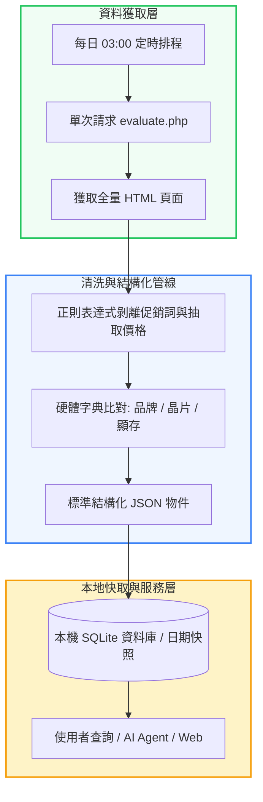

# 台灣電腦零組件終端售價查詢免費資源、原價屋資料結構與開源工具全景研調報告 (Frontier 3.0 基準版)

> **專案代號**：`taiwan-pc-hardware-retail-pricing-free-resources-frontier-3.0`  
> **核心主題**：電腦 DIY 零件（CPU、主機板、顯示卡、SSD、RAM 等）終端售價之免費查詢資源全景、原價屋 (CoolPC) / 欣亞數位 (Sinya) 資料結構逆向、開源歷史價格追蹤工具與工程防爬避坑指南。  
> **方法論**：遵循 ASD-STE100 受控繁體中文、通路定價生態拆解、開源工具實測比對與架構反模式防禦。

---

## Executive Summary & BLUF (結論先行)

針對使用者提問「是否有免費資源可以查詢各種電腦零組件終端售價（例如原價屋）？」，本研調提煉四大核心結論：

1. **官方層面：原價屋與欣亞「完全沒有官方公開 API」**：
   - 台灣主流實體通路（原價屋、欣亞）基於伺服器負載防護、報價商業壁壘與人工審單流程，**從未釋出任何公開的免費 REST/JSON API**。
   - 估價系統為傳統服務端渲染 (SSR) 之 HTML，且有基本的連線頻率限制防火牆。
2. **開源與社群層面：存在「四大成熟且完全免費」的現成獲取途徑**：
   - **途徑一（現成開源歷史庫）**：**`CoolPC Price Tracker` (原價屋價格追蹤)**，透過 GitHub Actions 每日自動快照，免寫程式即可在網頁端比對任意兩天的漲跌幅與上下架明細；電商則有 **`TWBuyer.info`** 追蹤 PChome/momo 歷史走勢。
   - **途徑二（開發者開源爬蟲 & MCP）**：GitHub 上已有開源專案如 **`shyuan/coolpc-mcp-server`**（封裝 `coolpc_parser.py` 直接輸出 JSON，支援 AI Agent 調用）與 **`coolpc-skill`**。
   - **途徑三（用戶端油猴腳本）**：**Tampermonkey 腳本**（如「原價屋估價單助手」），直接在瀏覽器端 DOM 層計算功耗與性價比 (CP 值)，零伺服器維護成本。
   - **途徑四（跨電商與國際庫）**：**BigGo / 飛比價格** 提供即時歷史低點外掛；國際級組裝相容性與規格標竿則有 **`PCPartPicker` (搭配開源 `py-pcpartpicker` 庫)**。
3. **原價屋資料結構核心挑戰：非結構化「字串雜燴」**：
   - 原價屋將品牌、晶片型號、散熱規格、保固、搭機條件與價格全部塞在單一文字選項中，純依賴 Regex 極易因活動詞彙破碎，現代最佳實踐為「正則預過濾 ＋ 字典對齊 ＋ 輕量 LLM 結構化」。
4. **工程落地黃金守則：嚴禁即時在線爬取，改採「每日快照 ＋ 本地 SQLite」**：
   - 即時在線抓取是嚴重架構反模式（延遲高達數秒且極易遭 IP 封鎖）。
   - 最佳實踐為每日凌晨排程執行單次爬取並存入本機 SQLite，前端查詢以 $< 1\text{ms}$ 讀取本地快取，達成 **0 封號風險、0 延遲與歷史趨勢自動累積**。

---

## 一、四大免費硬體價格查詢途徑對比矩陣

| 途徑分類 | 代表性工具 / 專案 | 運作機制 | 適合受眾 | 優勢與局限 |
| :--- | :--- | :--- | :--- | :--- |
| **一、現成歷史價格庫** | **CoolPC Price Tracker** TWBuyer.info | GitHub Actions 每日抓取快照存為靜態 JSON | 一般組機玩家、比價者 | 🟢 **免寫程式、0 封鎖風險**。 🟡 僅記錄每日快照，非秒級即時。 |
| **二、開發者 MCP / 爬蟲** | **`coolpc-mcp-server`** `coolpc-skill` 自建 Python 腳本 | 解析 `evaluate.php` HTML 提取結構化資料 | 開發者、AI Agent、自研比價系統 | 🟢 **可自訂格式、支援自動配單**。 🟡 需注意原價屋 Rate-limit 防火牆。 |
| **三、瀏覽器端油猴腳本** | 原價屋估價單助手 AI 建議估價清單 | Tampermonkey 注入瀏覽器 DOM 擴充功能 | 原價屋常客、現場配單玩家 | 🟢 **零主機成本、不觸發爬蟲風控**。 🟡 僅限瀏覽器使用，無法自動化輸出。 |
| **四、跨電商與國際資料庫** | **BigGo / 飛比價格** PCPartPicker | 全網商城爬蟲與全球硬體規格資料庫 | 跨通路比價、國際硬體規格比對 | 🟢 **硬體相容性最強、商城覆蓋廣**。 🟡 國際站點價格非台幣在地通路價。 |

---

## 二、原價屋資料解析與工程管線流程圖

---

## 三、專案章節目錄與研調導航

- 📚 **[文獻與檔案來源清單 (sources/README.md)](sources/README.md)**：收錄原價屋、欣亞、GitHub 開源 MCP/爬蟲倉庫、以及跨電商歷史比價平台清單。
- 📑 **[第一章：台灣電腦零組件定價生態系與「原價屋」資料結構剖析 (01-taiwan-hardware-pricing-landscape-and-coolpc.md)](01-taiwan-hardware-pricing-landscape-and-coolpc.md)**：解構原價屋全台定價錨點地位、官方未提供 API 的商業歸因、以及 `evaluate.php` 非結構化「字串雜燴」的逆向特徵。
- 📑 **[第二章：免費資源全景矩陣：開源爬蟲、歷史追蹤庫、瀏覽器腳本與跨國資料庫 (02-free-apis-crawlers-and-historical-trackers.md)](02-free-apis-crawlers-and-historical-trackers.md)**：全景盤點四大免費獲取管道（CoolPC Price Tracker、`coolpc-mcp-server`、Tampermonkey 油猴腳本、PCPartPicker），並提供 20 行 Python 爬蟲實例。
- 📑 **[第三章：工程落地架構、防爬蟲風控避坑與資料正規化實戰指南 (03-engineering-implementation-and-rate-limit-mitigation.md)](03-engineering-implementation-and-rate-limit-mitigation.md)**：剖析即時爬取的架構反模式、詳解「每日離峰快照 ＋ 本機 SQLite 快取」黃金架構、非結構化商品命名三階段清洗管線、以及爬蟲道德法規邊界。
